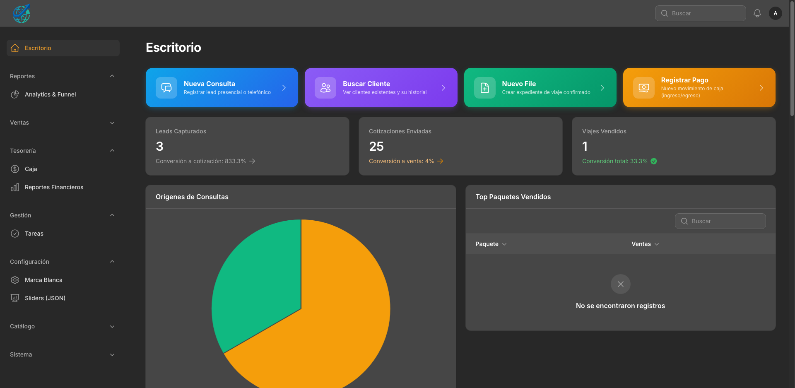
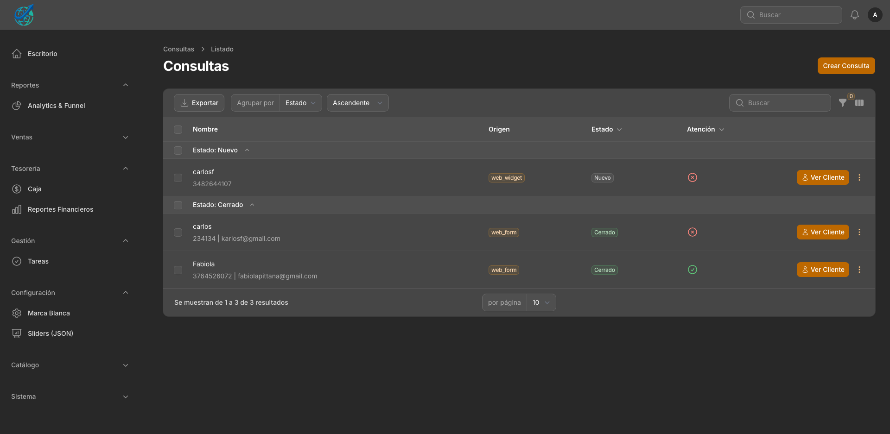
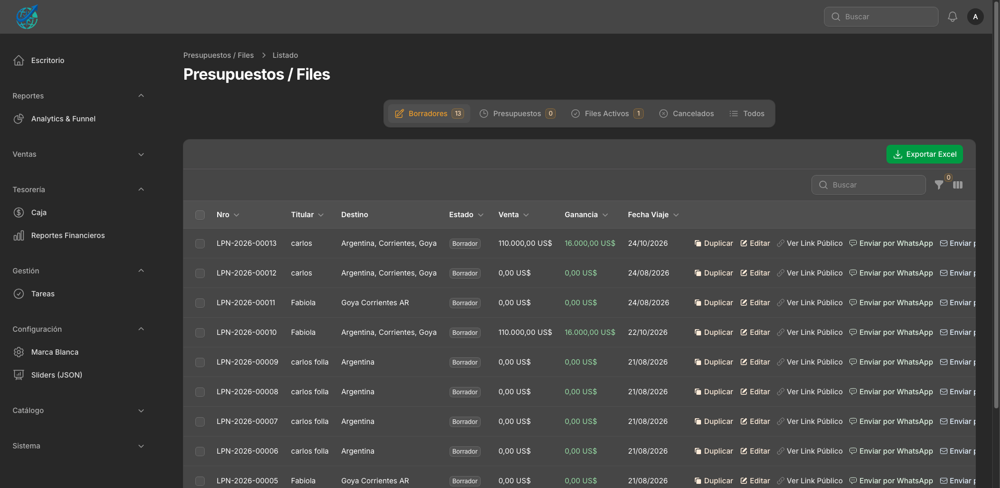
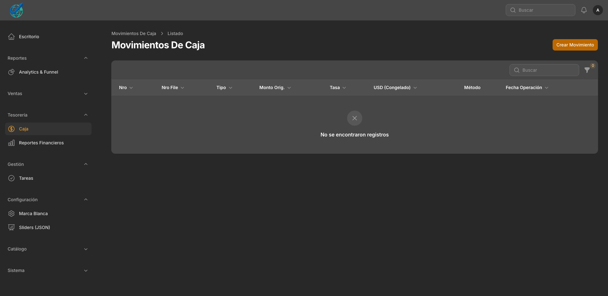

# 📘 Manual de Usuario: Omni-Agent

> [!TIP]
> **¡Bienvenido a la guía simple de tu sistema de gestión de viajes!** Aquí te explicamos cómo usar el panel paso a paso, de forma amigable y sin palabras difíciles. Aprenderás a manejar toda tu agencia de viajes desde un solo lugar.

---

## 1. 🚀 ¿Cómo entrar al sistema?

Para empezar a trabajar, solo necesitas seguir estos sencillos pasos:

1. Abre la página web principal de la agencia en tu navegador.
2. Busca el botón con el ícono de una **personita** (arriba a la derecha) o el que dice **"Ingresar"**.
3. Escribe tu correo electrónico y la contraseña que te proporcionaron los administradores.
4. **¡Listo!** Ya estás adentro de tu panel de control.

---

## 2. 📇 Gestión de Contactos (Clientes y Proveedores)

El sistema te permite guardar la información de todas las personas y empresas con las que trabajas, ¡como una agenda inteligente!

*   👤 **Clientes:** Aquí guardas los datos de las personas que viajan. Puedes anotar su nombre, teléfono, correo y ver el historial completo de todos los viajes que hicieron contigo.
*   🏢 **Proveedores:** Son las empresas a las que les compras los servicios (ej. aerolíneas, hoteles, asistencia al viajero). Tenerlos aquí te ayudará a saber fácilmente los saldos pendientes de pago.

---

## 3. 🚦 El Semáforo de Consultas (Leads)

Cuando entras al sistema, verás una lista de personas interesadas en viajar. Las llamamos **"Consultas"** o **"Leads"**. Imagínalo como un semáforo que te indica a quién debes atender con mayor urgencia.

> [!NOTE]
> **¿Qué significan los colores?**
> *   🔴 **ROJO (Caliente):** ¡Atención inmediata! Esta persona quiere comprar YA o tiene un presupuesto alto. **Llámalo lo antes posible.**
> *   🟡 **AMARILLO (Tibio):** Está interesado, pero se encuentra comparando precios. Hay que hacerle un buen seguimiento.
> *   🔵 **AZUL (Frío):** Solo está haciendo preguntas. Puede comprar en el futuro, pero no es tan urgente.

**📋 La lista ya viene ordenada por urgencia.** Arriba están las que piden hablar con una persona, después las que tienen el seguimiento vencido, después las calientes y al final el resto. Empieza siempre por la pestaña **"Para hoy"** y trabaja de arriba hacia abajo. También tienes las pestañas **Seguimiento vencido**, **Calientes**, **Sin asignar**, **Abiertas** y **Todas**, cada una con su contador.

**🗂️ Tablero de consultas.** En **Ventas → Tablero de consultas** ves las consultas en columnas por etapa: *Nueva*, *En curso*, *Cotizada* y *Reservada*. **Arrastra una tarjeta** a otra columna para cambiarle el estado. Úsalo una vez por semana para revisar tu embudo de ventas.

**🤖 Consultas Automáticas con IA:**
Si un cliente visita tu página y escribe en el chat, o te escribe por **WhatsApp, Instagram o Messenger**, el sistema crea la consulta por ti. Nuestra **Inteligencia Artificial** lee el mensaje y extrae los datos clave (destino, pasajeros, fechas) automáticamente. ¡Cero esfuerzo manual!

---

## 4. ⏰ Tareas y Recordatorios

Para que no te olvides de llamar a un cliente o hacer un pago, el sistema cuenta con una sección de **Tareas**.
Crea una tarea, asígnale una fecha límite y déjatela a ti mismo o a un compañero. ¡Es tu agenda diaria para organizarte mejor!

---

## 5. 🗺️ Armado de Viajes (Presupuestos y Expedientes)

Esta es tu herramienta principal para crear el viaje perfecto. Puedes iniciar desde cero o aprovechar paquetes ya armados.

### Diferencias Clave:

| Tipo | ¿Qué es? | ¿Para qué sirve? |
| :--- | :--- | :--- |
| 📝 **Presupuesto (Quote)** | Es una cotización inicial. | El cliente lo está pensando. Puedes editarlo o borrarlo sin problemas. |
| ✅ **Expediente (File)** | Viaje confirmado. | El cliente dijo **"SÍ"**. Genera un número oficial y comenzamos a registrar pagos y reservas. |

### Pasos para armar un viaje:
1. Ve a **"Ventas"** y selecciona **"Presupuestos"** o **"Expedientes"**.
2. Elige al cliente o crea uno nuevo en un clic.
3. En **"Servicios"**, agrega lo que necesitas (Vuelo, Hotel, Traslado) seleccionando también el Proveedor.
4. Ingresa tu costo (lo que pagas al proveedor) y el precio de venta (lo que cobra el cliente).
5. ¡El sistema calcula tus ganancias automáticamente!

> [!TIP]
> **Atajo Mágico:** Desde una Consulta (Lead), abre el menú **⋯** y usa **"Crear Expediente"**. El sistema copiará todos los datos para ahorrarte tiempo.

### Seguimiento de pasajeros:
En **Presupuestos / Files** tienes pestañas que te dicen qué hacer, ordenadas por fecha de viaje:
*   ✈️ **Viajan en 30 días:** los viajes confirmados que salen pronto.
*   💸 **Cuotas vencidas:** quién tiene pagos atrasados.
*   📄 **Sin vouchers:** viajes que salen en 45 días o menos y todavía no tienen documentos.
*   ⌛ **Presupuestos por vencer:** cotizaciones que vencen en los próximos 3 días.

### Interactúa con tu cliente:
*   📘 **PDF Presupuesto (Celeste):** Descarga un resumen elegante del viaje.
*   📒 **PDF Acuerdo (Amarillo):** Genera el contrato para firmar.
*   📲 **Enviar PDF por WhatsApp:** Manda el presupuesto en PDF directo a la conversación de WhatsApp del cliente, con un mensaje que puedes editar. Funciona si el cliente te escribió en las últimas 24 horas.
*   🟩 **Abrir en WhatsApp:** Abre WhatsApp en tu computadora o celular con un mensaje pre-armado y el link del presupuesto.

---

## 6. 💬 Mensajes y Bot Recepcionista

Todos los mensajes de **WhatsApp, Instagram y Messenger** llegan a un solo lugar: **Chat → Bandeja de mensajes**.

*   🤖 **Bot recepcionista:** responde los primeros mensajes, resuelve dudas generales y junta los datos del viaje (destino, fechas, pasajeros, presupuesto). En WhatsApp, cuando la pregunta es de respuesta cerrada, manda **botones** para que el cliente conteste con un toque.
*   🚫 **Lo que nunca hace:** dar precios finales, formas de pago ni datos bancarios. Si le preguntan eso, avisa al equipo.
*   🙋 **Cuando respondes tú** (desde el sistema o desde el celular), el bot se pausa en esa conversación.
*   🔔 **Avisos:** en **Chat → Avisos** ves cuándo un cliente necesita una persona, cuándo el bot ya tiene todos los datos para cotizar y cuándo abrió una consulta nueva que hay que confirmar.

> [!WARNING]
> **Regla de las 24 horas:** solo puedes escribir libremente hasta 24 horas después del último mensaje del cliente. Después, en WhatsApp, solo se pueden enviar **plantillas aprobadas** por Meta.

El administrador configura qué dice el bot en **Chat → Bot recepcionista** y puede probarlo con el botón **"Probar bot"** antes de encenderlo.

---

## 7. 💰 Tesorería y Dinero (La Caja)

Lleva un control exacto de todo el dinero que entra y sale de la agencia.

**Estructura:**
*   🏦 **Cuentas Financieras:** Tus cajas virtuales (Caja Fuerte, Banco, MercadoPago).
*   🏷️ **Categorías de Transacción:** Para organizar tus finanzas (Cobro, Pago a Proveedor, Sueldos, Alquiler).

**Cómo registrar un cobro:**
1. Ve a **"Tesorería"** -> **"Transacciones"** -> **"Nueva Transacción"**.
2. Selecciona **Ingreso**.
3. Asocia el pago al **Expediente** del cliente.
4. Indica el monto, la **Cuenta** y la **Categoría**.
5. Presiona **Guardar**. ¡Aplica igual para pagos a proveedores (Egreso)!

---

## 8. 🌴 Tu Vidriera Web (Catálogo y Sliders)

Administra lo que ven tus clientes en tu sitio web directamente desde el panel. ¡Sin saber programar!

*   📸 **Sliders (Banners):** Las imágenes destacadas del inicio. Sube fotos atractivas y botones que enlacen a tus mejores ofertas.
*   🏖️ **Ideas de Viaje (Paquetes):**
    * Ve a **"Catálogo"** → **"Ideas de Viaje"** → **"Nuevo"**.
    * Usa **"Idea Rápida"** para algo breve, o completa el itinerario detallado con galería de fotos. ¡Se publica en la web de inmediato!

---

## 9. 🎨 Personalizar el Sistema (Configuración)

Adapta el sistema para que lleve los colores y el estilo de tu marca.

1. Ve a **"Configuración"**.
2. **Identidad:** Sube tu logotipo y configura tus colores.
3. **Legal y Acuerdos:** Define tu contrato base. Utiliza variables automáticas como `[NOMBRE_CLIENTE]` o `[TOTAL_VIAJE]` para personalizar cada PDF que generes.

---

## 10. 🔐 Equipo y Accesos (Usuarios y Roles)

Si tienes un equipo, dales acceso controlado al sistema.

> [!WARNING]
> **Permisos de Usuario:** Cada rol tiene un nivel de acceso diferente para proteger tu información confidencial, especialmente las ganancias totales.

**Roles disponibles:**
*   👑 **Administrador:** Acceso total. Puede gestionar usuarios, diseño web y visualizar ganancias ocultas.
*   💰 **Finanzas:** Manejan la tesorería de la empresa.
*   💼 **Ventas:** Asesores que crean presupuestos y expedientes, pero no ven la rentabilidad global.
*   👤 **Staff / Usuario General:** Acceso básico. El administrador puede sumarle permisos puntuales: Consultas, Presupuestos, Clientes, Catálogo, Caja o Reportes.

> [!NOTE]
> Solo un **Administrador** puede crear usuarios, cambiar roles y dar permisos. Nadie puede darse permisos a sí mismo.

---
*Manual actualizado para Sistema Omni-Agent (noviembre 2026) - Incluye Gestión Integral, IA, Bot recepcionista, WhatsApp, Instagram y Messenger, Tareas, Tesorería y Web.*
