# Manual de usuario

Referencia completa del sistema, pantalla por pantalla. Si preferís aprender con ejemplos, usá los **Tutoriales** (documento 02).

**Índice**

1. Cómo está organizado el sistema
2. Ingresar y roles del equipo
3. El Escritorio (pantalla de inicio)
4. Consultas (leads)
5. Clientes
6. Presupuestos y expedientes (files)
7. Moneda y cotización
8. Plan de pagos y cuotas
9. Caja: cobros y pagos
10. Proveedores, cuentas y categorías
11. Seguimiento automático y tareas
12. Bandeja de mensajes y bot recepcionista (WhatsApp, Instagram y Messenger)
13. Ideas de Viaje y el Importador
14. La vidriera web y sus formularios
15. Portal del cliente
16. Configuración de la agencia
17. Reportes
18. Glosario y preguntas frecuentes

---

## 1. Cómo está organizado el sistema

El sistema tiene dos partes:

- **El sitio público**, que ven tus clientes: catálogo de ideas de viaje, chat con asistente virtual, formulario de consulta, cotizador y la página privada de cada presupuesto.
- **El panel de administración** (el que usás vos y tu equipo), con el menú a la izquierda.

El recorrido típico de un viaje es:

> **Consulta** → **Presupuesto** (se envía al cliente) → **Señado** (el cliente paga la seña) → **Cuotas y cobros** → **Emitido** (viaje listo) → cierre y reportes

Todo lo que pasa queda registrado: quién hizo qué, cuándo se envió un presupuesto, cuántas veces lo abrió el cliente, cada cobro y cada pago.

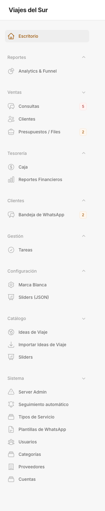

## 2. Ingresar y roles del equipo

Entrá desde la dirección del panel de tu agencia (termina en `/admin`) con tu correo y contraseña. Si la olvidaste, pedile a un administrador que la cambie desde *Sistema → Usuarios*.

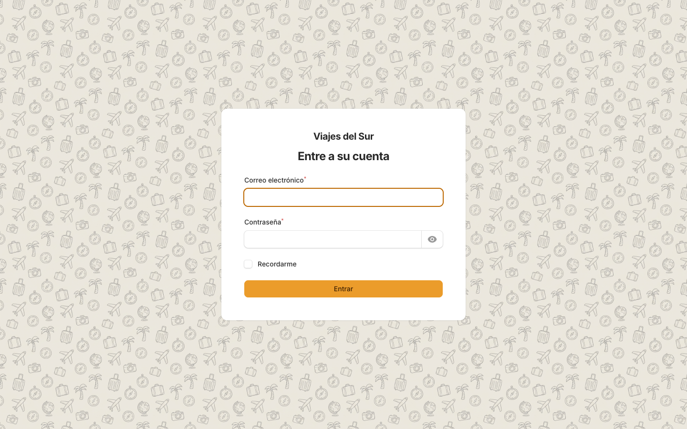

| Rol | Qué puede hacer |
|---|---|
| **Administrador** | Todo: usuarios, configuración, finanzas, sistema. |
| **Ventas** | Trabaja consultas y presupuestos. **Ve sus propios expedientes** y los que todavía no tienen vendedor. No ve los reportes financieros. |
| **Finanzas** | Ve **todos** los expedientes, la Caja y los **Reportes Financieros**. |
| **Staff / Usuario** | Acceso básico. El administrador puede darle permisos puntuales desde *Sistema → Usuarios*. |
| **Cliente** | Solo accede al portal del cliente (sección 15). |

**Permisos puntuales.** Además del rol, el administrador puede sumarle a una persona estos accesos:

| Permiso | Qué habilita |
|---|---|
| **Gestionar Consultas** | Consultas, tablero, bandeja de mensajes. |
| **Gestionar Presupuestos / Files** | Presupuestos, expedientes, proveedores y tipos de servicio. |
| **Gestionar Clientes** | La agenda de clientes, con sus documentos. |
| **Gestionar Catálogo / Ideas de Viaje** | Ideas de viaje, importador y banners. |
| **Gestionar Caja** | Caja, cuentas y categorías. |
| **Ver Reportes Financieros** | Los reportes de Tesorería. |

> **Importante:** el rol de una persona, sus permisos y la lista de usuarios solo los maneja un **administrador** desde *Sistema → Usuarios*. Nadie más puede crear usuarios ni cambiarse sus propios permisos. Un administrador tampoco puede borrar su propia cuenta.

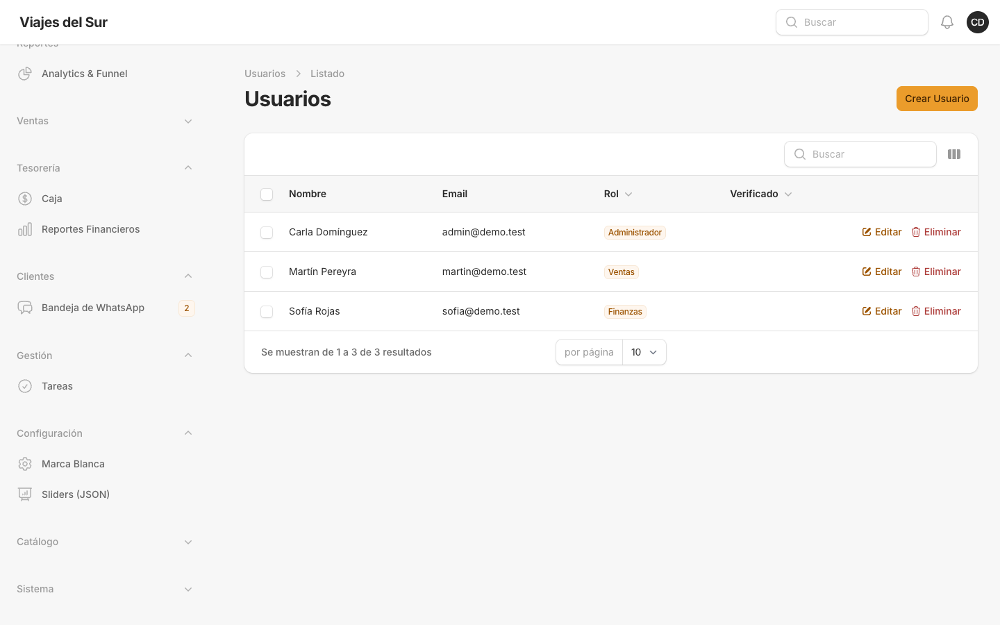

## 3. El Escritorio (pantalla de inicio)

Al entrar ves el **Escritorio**, con lo importante del momento (algunas tarjetas aparecen según tu rol):

| Qué ves | Para qué sirve |
|---|---|
| **Accesos rápidos** (Nueva Consulta, Buscar Cliente, Nuevo File, Registrar Pago) | Los cuatro atajos más usados. |
| **Leads Capturados · Cotizaciones Enviadas · Viajes Vendidos** | El recorrido comercial con sus porcentajes de conversión. |
| **Orígenes de Consultas / Fuentes de Leads** | De dónde llegan tus consultas (chat, formulario, cotizador, WhatsApp). |
| **Top Paquetes Vendidos** | Las ideas de viaje que más se venden. |
| **Ventas Mes Actual · Gross Profit · Tasa de Conversión** | Ventas del mes y ganancia, en USD. |
| **Mis Tareas Pendientes** | Tu agenda del día (incluye las tareas automáticas). |
| **Velocidad de respuesta** | Cuánto tardás en promedio en contactar una consulta nueva y qué porcentaje de presupuestos enviados abrió el cliente. |
| **Funnel de Conversión** | Consultas → presupuestos → reservas confirmadas. |
| **Atención Necesaria · Nuevas Consultas** | Cuántas consultas esperan a una persona y cuántas todavía no se atendieron. |
| **Cobranzas** | Cuotas vencidas y cuotas que vencen en los próximos 7 días, con el monto pendiente en USD. |
| **Ingresos · Egresos · Balance Neto (Mes Actual)** | Cobros y pagos del mes, en USD. |
| **Próximas Salidas Confirmadas** | Los viajes que salen pronto. |
| **Resultados Financieros (Año Actual)** | Gráfico mensual de ingresos y egresos. |
| **Cotizaciones** | El dólar del día (Oficial, MEP, Tarjeta), con un botón para actualizar. |
| **Aviso "El cron no está corriendo"** | Solo para administradores y solo si hay un problema: los envíos automáticos están frenados (ver Guía de administración). |

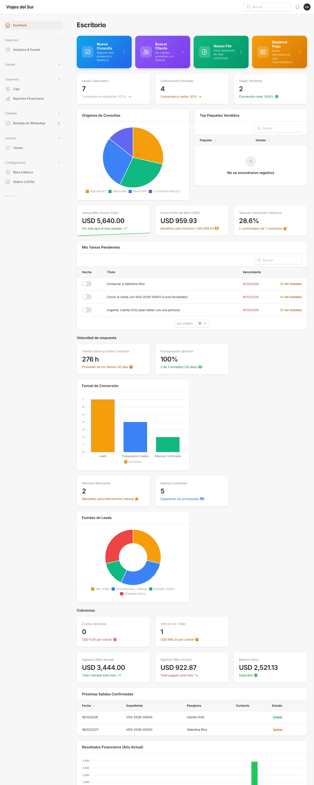

## 4. Consultas (leads)

*Menú: **Ventas → Consultas***

Una **consulta** es una persona interesada en viajar. Entran solas por varios caminos y el sistema anota el **origen**:

- el **chat** del sitio (con asistente virtual) ⚙️ *la IA requiere configuración*,
- el **formulario de consulta**,
- el **cotizador** (la persona completa destino, fechas y pasajeros),
- **WhatsApp, Instagram y Messenger** (sección 12),
- una conexión externa (API), si la agencia la usa.

El mismo cliente que vuelve a escribir no se duplica: se reconoce por su email o teléfono. Quien no deja ningún dato de contacto se guarda como una consulta separada (no se mezcla con otras).

### Estados y temperatura

| Estado | Significado |
|---|---|
| **Nueva** | Nadie la atendió todavía. |
| **Por verificar** | El bot recepcionista abrió una segunda consulta para un cliente que ya tenía otra. Confirmala o unila desde *Chat → Avisos* (sección 12). |
| **En curso** | Ya se habló con la persona. Pasa sola al responderle o al cambiar el estado. |
| **Cotizada** | Ya tiene un presupuesto enviado. |
| **Reservada** | Compró: tiene un expediente confirmado. |
| **Cerrada** | Terminó sin compra o se descartó. |

| Temperatura | Significado |
|---|---|
| 🔴 **Caliente** | Quiere comprar ya o pidió hablar con una persona: llamala primero. |
| 🟡 **Tibio** | Interesado, compara. Hacele seguimiento. |
| 🔵 **Frío** | Solo pregunta. |

### La lista: lo más urgente primero

La lista de consultas **ya viene ordenada por urgencia**, así que siempre empezás por arriba:

1. las que **piden una persona** (columna *Atención*),
2. las que tienen el **seguimiento vencido**,
3. las **calientes**,
4. el resto, por la fecha del **próximo seguimiento** (las que no tienen fecha van al final).

Arriba hay **pestañas** con un contador, que funcionan como tus colas de trabajo:

| Pestaña | Qué muestra |
|---|---|
| **Para hoy** *(se abre por defecto)* | Las consultas abiertas que piden una persona, las nuevas y las que tienen seguimiento hasta hoy. |
| **Seguimiento vencido** | Las que tenían que volver a contactarse y no se hizo. |
| **Calientes** | Las abiertas con temperatura caliente. |
| **Sin asignar** | Las abiertas que no tienen vendedor. |
| **Abiertas** | Todas las que no están reservadas ni cerradas. |
| **Todas** | Todo el historial. |

En cada fila ves el nombre con el **destino** y el teléfono debajo, la **temperatura**, el **estado**, el **próximo seguimiento** (en rojo si ya pasó) y el **último contacto**. Si preferís otro orden, hacé clic en el título de una columna. También podés agrupar por estado y filtrar por estado, temperatura o *Seguimiento atrasado*.

> Un vendedor ve y cuenta solo **sus** consultas y las que todavía no tienen vendedor.

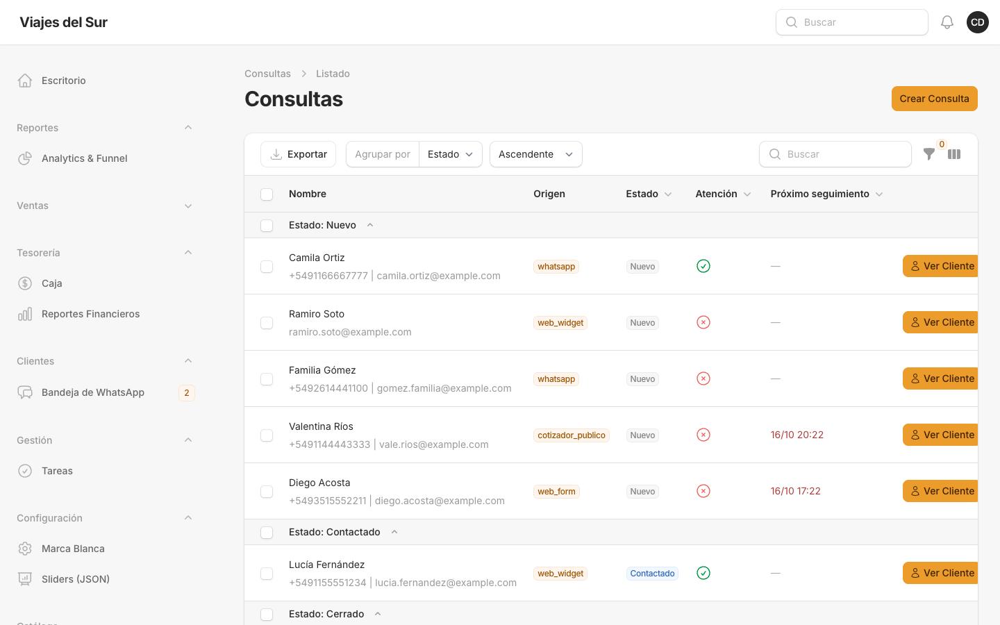

### El tablero de consultas

*Menú: **Ventas → Tablero de consultas** (o el botón **Ver tablero** arriba de la lista)*

Muestra las consultas en **columnas por estado**: *Nueva*, *En curso*, *Cotizada* y *Reservada*. La columna *Por verificar* aparece solo cuando el bot dejó consultas para confirmar, y *Cerrada* se muestra si tildás **Mostrar cerradas**.

- **Arrastrá una tarjeta a otra columna** para cambiarle el estado.
- Dentro de cada columna, **lo más urgente queda arriba**, con el mismo orden que la lista.
- Cada tarjeta muestra el destino, la temperatura (con una franja roja si es caliente y amarilla si es tibia), la fecha de seguimiento (en rojo si venció), el último contacto y el vendedor. Un clic abre la consulta.
- Arriba podés tildar **Solo mis consultas** y **Solo calientes**.
- Cada columna muestra hasta 50 tarjetas. Si hay más, lo indica y las encontrás en la lista.

> **¿Lista o tablero?** Usá la **lista** para el trabajo de todos los días: te dice a quién atender primero. Usá el **tablero** para la revisión semanal del embudo: ver cuántas consultas hay en cada etapa y moverlas.

### Lo que completa la inteligencia artificial

Cuando hay IA configurada, lee la conversación y completa: **destino, presupuesto, pasajeros, fecha o quincena, noches, ciudad de salida y nombre**, y arma un resumen. Si el **bot recepcionista** está encendido, además anota fechas desde y hasta, edades de los menores, pasaporte y visa, si lo quiere todo incluido, y se acuerda de lo que no cambia entre viajes (sección 12). Todo es editable: la IA ayuda, no decide.

### Acciones sobre una consulta

Menú ⋯ de cada fila:

- **WhatsApp:** abre un chat con un mensaje de presentación listo.
- **Editar:** cambiar datos, estado, vendedor asignado.
- **Escalar a humano:** marca la consulta como urgente.
- **Crear Expediente:** arma el presupuesto copiando destino, pasajeros y datos de la consulta.
- **Ver Cliente:** abre la ficha del cliente.

> Si la agencia activó la **asignación automática**, cada consulta nueva se reparte sola entre los vendedores (al que menos pendientes tiene). Si no, las consultas sin vendedor las ve todo el equipo.

## 5. Clientes

*Menú: **Ventas → Clientes***

La agenda de personas que viajan. Cada ficha guarda nombre, teléfono, email, documento y pasaporte, y el historial de consultas y viajes. Podés crear clientes nuevos desde acá o "al vuelo" mientras armás un expediente.

Dentro de la ficha, la pestaña **Consultas** lista todas las consultas del cliente con su destino, estado, vendedor, canal y último mensaje, y un botón para abrir la **Conversación** en la bandeja.

> El documento y el pasaporte son lo que el cliente usa para entrar a su portal (sección 15). Por eso esta sección solo la ven quienes tienen permiso de clientes, consultas o presupuestos.

## 6. Presupuestos y expedientes (files)

*Menú: **Ventas → Presupuestos / Files***

Un mismo registro cambia de estado a medida que avanza:

| Estado | Qué significa |
|---|---|
| **Borrador** | Lo estás armando. |
| **Presupuesto** | Listo para el cliente. |
| **Señado** | El cliente pagó la seña. **Pasa solo** cuando se cobra la primera cuota del plan de pagos. |
| **Emitido** | Viaje confirmado y documentación emitida. |
| **Cancelado** | Se cayó. |

Cada expediente tiene un **número automático** (por ejemplo `LPN-2026-00001`). El prefijo se cambia en *Configuración → Finanzas*.

### Las pestañas del listado

Además de las pestañas por estado (*Borradores*, *Presupuestos*, *Files Activos*, *Cancelados*, *Todos*), hay cuatro **colas de seguimiento de pasajeros**, ordenadas por fecha de viaje:

| Pestaña | Qué muestra |
|---|---|
| **Viajan en 30 días** *(se abre por defecto)* | Expedientes señados o emitidos que salen en los próximos 30 días, el más cercano primero. |
| **Cuotas vencidas** | Expedientes con alguna cuota impaga cuyo vencimiento ya pasó. |
| **Sin vouchers** | Expedientes señados o emitidos que viajan en 45 días o menos y todavía no tienen vouchers cargados. |
| **Presupuestos por vencer** | Borradores y presupuestos cuya validez termina en los próximos 3 días. |

Cada pestaña muestra cuántos expedientes tiene. Si un número no está en cero, hay algo para hacer.

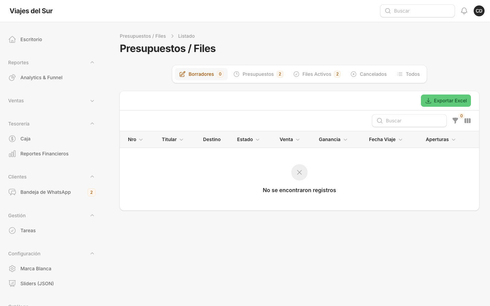

### Armar un expediente

1. **Información general:** cliente, vendedor, consulta de origen (copia destino, pasajeros, noches, fecha), titular, fechas y vencimiento del presupuesto.
2. **Pasajeros:** nombre, documento, nacimiento, nacionalidad y foto del documento de cada viajero.
3. **Detalle de servicios:** cada línea es un servicio (vuelo, hotel, traslado…):
   - tipo de servicio y descripción,
   - **proveedor**,
   - **moneda** (USD, ARS, EUR, BRL),
   - si no es USD: la **cotización** (sección 7),
   - **costo neto** (lo que pagás) y **precio de venta** (lo que paga el cliente).
4. **Liquidación:** el sistema calcula solo **costo total, precio total y rentabilidad en USD**. Si cargaste servicios en pesos, también ves el subtotal en pesos como referencia.
5. **Información adicional:** notas para el pasajero y documentos (vouchers) que el cliente podrá descargar.
6. **Itinerario:** día por día.

> **Observaciones internas** nunca se ven en el presupuesto ni en el link público.

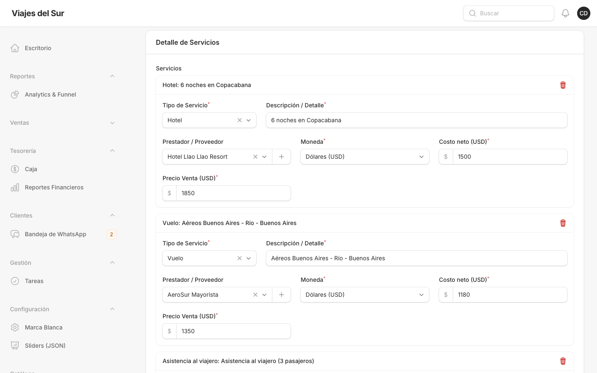

### Qué podés hacer con un expediente

Botones arriba a la derecha:

| Botón | Qué hace |
|---|---|
| **Enviar por Email** | Manda el presupuesto en PDF al correo del cliente. ⚙️ *Requiere correo saliente configurado.* |
| **Enviar PDF por WhatsApp** | Manda el **presupuesto en PDF** a la conversación de WhatsApp del cliente, con un mensaje que podés editar. Elegís *Solo Presupuesto* o *Presupuesto + Detalle de la Idea de Viaje*. El envío queda en la bandeja y en el historial del expediente. ⚙️ *Requiere WhatsApp conectado.* |
| **Abrir en WhatsApp** | Abre WhatsApp en tu computadora o celular con el mensaje y el link listos, para que lo mandes vos. |
| **Presupuesto (PDF)** | Descarga el PDF (con el plan de pagos si existe). |
| **Acuerdo (PDF)** | Genera el contrato con los datos del cliente. |
| **Ver Link Público** | Muestra el link privado del presupuesto para copiar y compartir. |
| **Renovar validez** | Aparece si el presupuesto venció: lo deja vigente 7 días más. |

**Sobre "Enviar PDF por WhatsApp":**

- Aparece solo si el cliente tiene una **conversación de WhatsApp** abierta en la bandeja y WhatsApp está conectado.
- Se puede usar dentro de las **24 horas** desde el último mensaje del cliente (es una regla de WhatsApp, sección 12). Fuera de ese plazo el botón queda gris y explica por qué: esperá a que el cliente vuelva a escribir o mandale una plantilla desde la bandeja.
- El cliente recibe el PDF como documento, igual que si se lo mandaras desde el celular.

En la parte de abajo del expediente hay pestañas: **Plan de Pagos**, **Movimientos de Caja**, **Itinerario del Viaje** y **Historial de Actividad** (el historial: creación, cambios de estado, envíos y *"el cliente abrió el presupuesto"*).

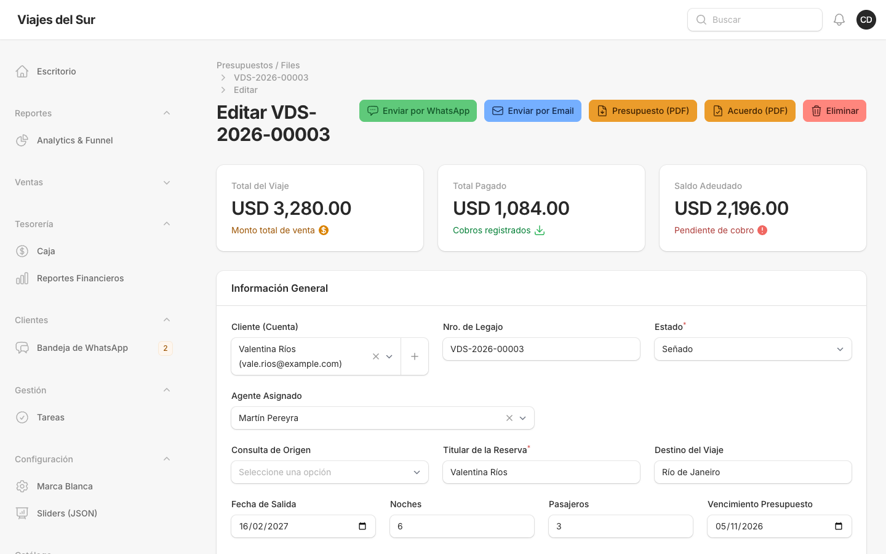

### El link público del presupuesto

Cada presupuesto tiene una página privada (que solo abre quien tiene el link) con el detalle del viaje, el precio total, el botón para escribirte por WhatsApp, la descarga del PDF y —si hay plan de pagos— **"Tu plan de pagos"** con las cuotas, su estado, el saldo y cómo pagar.

**No muestra costos, rentabilidad ni observaciones internas.** El sistema cuenta cuántas veces lo abre el cliente (no cuentan tus visitas ni las de robots), y eso alimenta el seguimiento automático.

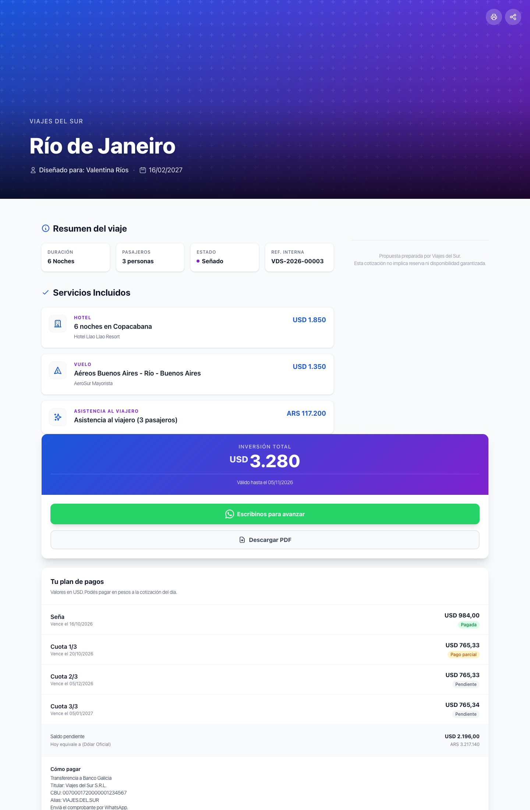

## 7. Moneda y cotización

**Regla general: los expedientes se llevan siempre en dólares (USD).** Eso hace que los saldos y la rentabilidad sean claros aunque el peso se mueva.

Cuando un servicio, un cobro o un pago es en otra moneda, el sistema pide la **cotización**:

1. Elegí la moneda (por ejemplo, Pesos Argentinos).
2. En **Cotización** aparece un selector con el valor del día de cada dólar:
   - **Dólar Oficial**, **Dólar MEP**, **Dólar Tarjeta**,
   - **Personalizado**: escribís vos el número.
3. Al elegir una, se completa el campo "**ARS por 1 USD**". También lo podés editar a mano (y pasa a *Personalizado*).
4. El sistema muestra a cuánto equivale en USD.

Detalles útiles:

- La cotización queda **guardada en cada servicio y en cada cobro**: el valor de un cobro de hace dos meses no cambia.
- El dólar que viene marcado por defecto se elige en *Configuración → Finanzas*.
- Si el sistema no puede obtener la cotización (sin internet o sin datos), **no deja guardar** hasta que la escribas: nunca convierte pesos como si fueran dólares.
- Euro y real se convierten pasando por el dólar del día.

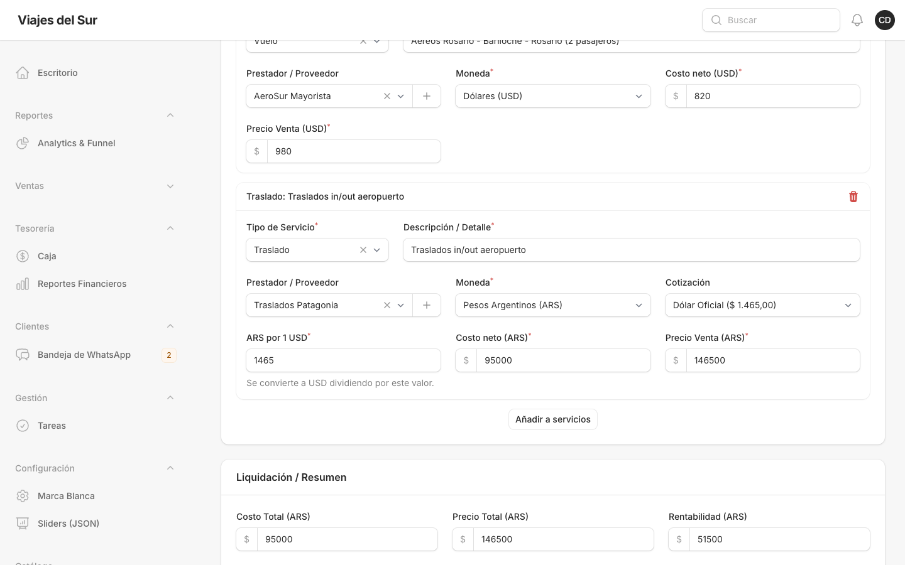

## 8. Plan de pagos y cuotas

*Dentro de un expediente → pestaña **Plan de Pagos***

### Generar el plan

Botón **Generar plan**. Completás:

- **Seña (%)** (por ejemplo 30),
- **Cantidad de cuotas** del saldo,
- **Primer vencimiento** de cuota,
- **Frecuencia** (semanal, quincenal, mensual).

El sistema crea la **Seña** (vence hoy) y las cuotas en USD. Los centavos que sobran del redondeo van a la última cuota.

**Regla de seguridad:** la última cuota debe vencer al menos **N días antes del viaje** (30 por defecto; se cambia en *Configuración → Finanzas*). Si el plan no cumple, el sistema te explica la fecha límite.

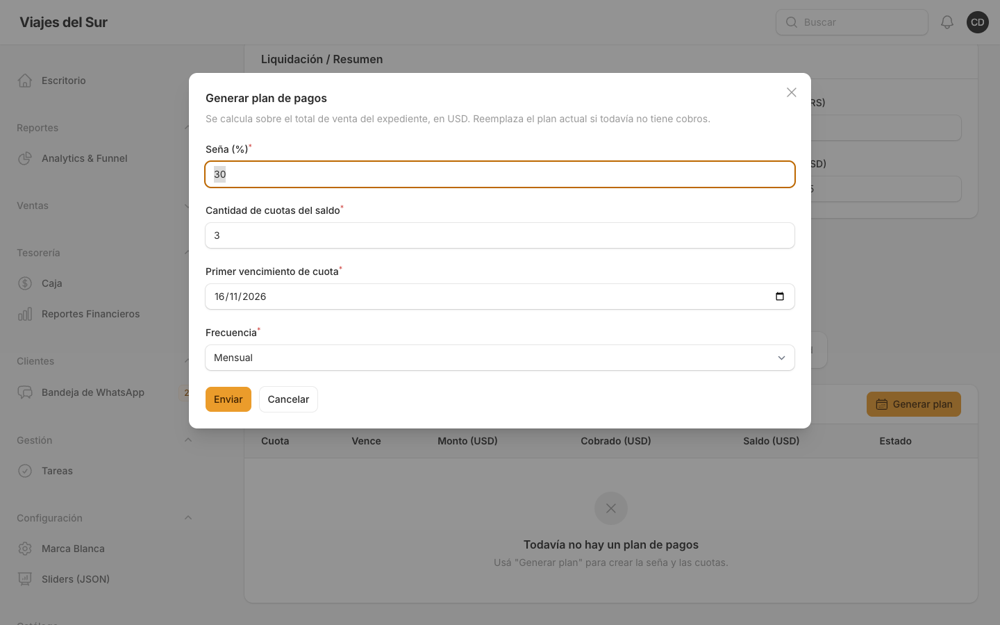

Mientras no haya cobros, podés volver a generar el plan; con cobros registrados ya no (para no perder el rastro).

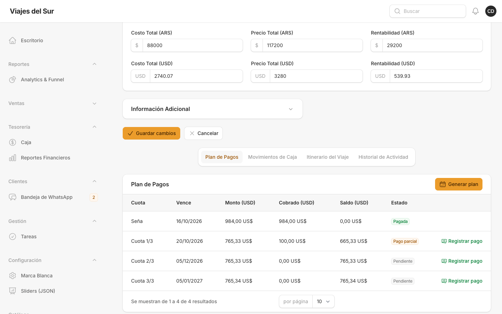

### Registrar un pago

En la fila de la cuota: **Registrar pago**. Elegís moneda (USD o pesos), monto, cotización si es en pesos, método y fecha. Se crea el cobro en la Caja y la cuota se actualiza sola.

También podés cargar el cobro directamente desde *Caja* y elegir **Imputar a cuota**. Si no elegís ninguna, el cobro se aplica a la **cuota más antigua pendiente**.

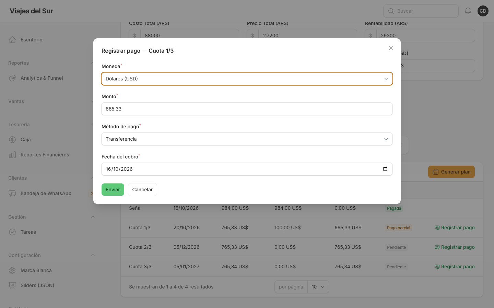

### Estados de la cuota

| Estado | Cuándo |
|---|---|
| **Pendiente** | Todavía no se cobró nada. |
| **Pago parcial** | Se cobró una parte. |
| **Pagada** | Cubierta por completo. |
| **Vencida** | Pasó la fecha y falta cobrar. |

Al **cobrar la seña**, el expediente pasa solo a **Señado**. Si borrás o corregís un cobro, las cuotas se recalculan.

### Recordatorios automáticos

Todos los días a las 9:00 el sistema avisa:

- **3 días antes** del vencimiento,
- **el día** del vencimiento,
- **2 días después** si sigue impaga.

El cliente recibe un **email** (⚙️ requiere correo configurado) y, si la agencia conectó WhatsApp y cargó la plantilla de recordatorio, también un **WhatsApp**. El vendedor recibe una **notificación** en el panel. Cada aviso se manda una sola vez. Los textos se personalizan en *Configuración → Finanzas → Plan de pagos y recordatorios*.

## 9. Caja: cobros y pagos

*Menú: **Tesorería → Caja***

Cada movimiento de dinero es una **transacción**:

- **Cobro (ingreso):** el cliente te paga.
- **Pago (egreso):** vos pagás a un proveedor, un gasto, un sueldo.

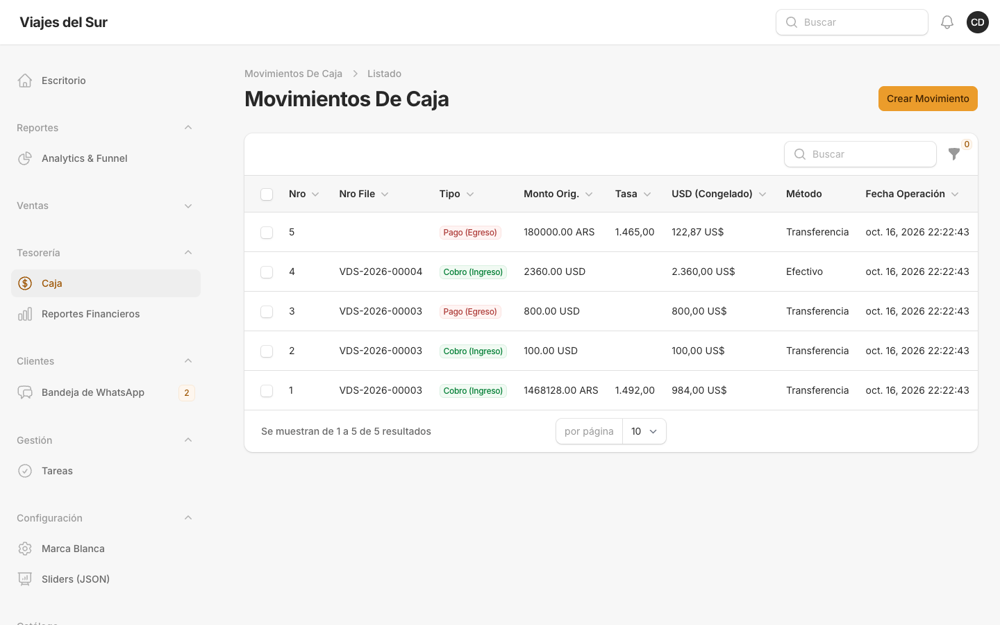

### Cargar un movimiento

1. **Tipo**, **método de pago** (efectivo, transferencia, tarjeta, Mercado Pago, USDT, cheque) y **cuenta financiera**.
2. **Categoría** (Pago de Pasajero, Pago a Proveedor, Gastos Administrativos, Publicidad…; podés crear otras).
3. **Expediente** (para cobros y pagos de un viaje) y **proveedor** (para pagos).
4. **Moneda y monto**. Si es en pesos, elegí la **cotización del día** (sección 7): ves en vivo *"Equivale a USD …"*.
5. **Fecha** del movimiento, notas y comprobante (foto o PDF).
6. Guardar.

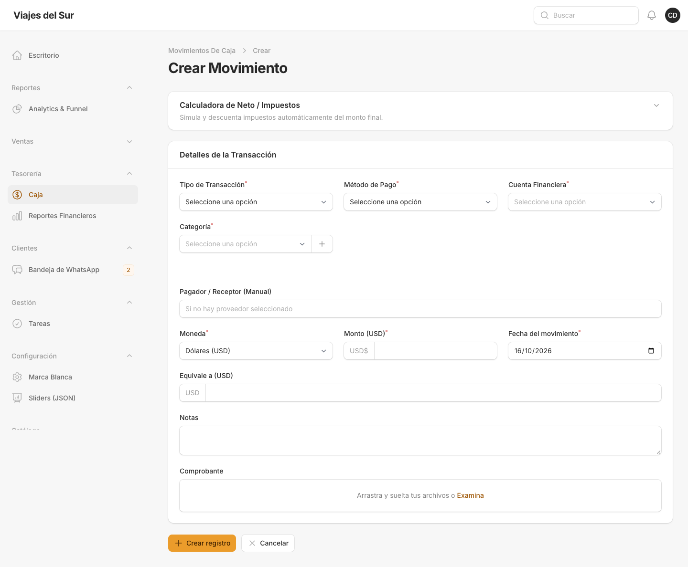

La **calculadora de neto e impuestos** (arriba, plegada) sirve cuando el medio de pago descuenta comisiones: cargás el monto bruto y los porcentajes (banco, IIBB, plataforma) y calcula lo que realmente recibís.

### Recibo

Desde un cobro podés descargar el **recibo en PDF** (muestra el método, la cotización y a qué cuota se imputó).

### Saldo del cliente

En cada expediente, arriba, ves **Total del viaje · Total pagado · Saldo adeudado**, todo en USD. Los cobros en pesos suman lo que valían el día que se pagaron.

## 10. Proveedores, cuentas y categorías

*Menú: **Sistema***

- **Proveedores:** hoteles, aerolíneas, mayoristas. Cada uno muestra el **saldo en USD** (lo que le debés: costos de los servicios que le cargaste menos lo que ya le pagaste). Guardan datos bancarios.
- **Cuentas:** tus "cajas" (caja fuerte, banco, Mercado Pago…), cada una con su moneda.
- **Categorías:** para ordenar ingresos y egresos.
- **Tipos de Servicio:** la lista de servicios que aparece al armar un expediente (vuelo, hotel, traslado…).

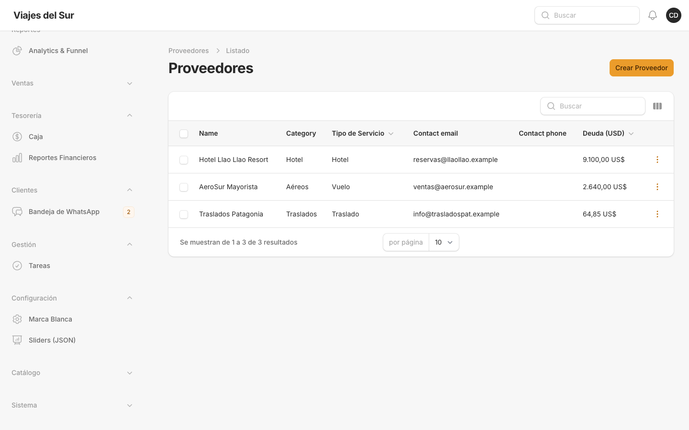

## 11. Seguimiento automático y tareas

*Menú: **Sistema → Seguimiento automático** (reglas) y **Gestión → Tareas***

Para que ninguna consulta ni presupuesto quede sin respuesta, el sistema revisa **cada hora** y actúa según **reglas** que vos podés prender, apagar y ajustar.

Las reglas que vienen listas:

| Cuándo | Espera | Qué hace |
|---|---|---|
| Consulta nueva **sin vendedor** | 2 h | Avisa a los administradores. |
| Consulta **sin contactar** | 24 h | Crea una tarea para el vendedor. |
| La persona **pide hablar con alguien** | enseguida | Crea una tarea urgente. |
| Presupuesto enviado y **no abierto** | 48 h | Tarea "Llamar a…". |
| Presupuesto **abierto 3 veces o más** y sin seña | 24 h | Tarea "Cerrar la venta con…". |
| Presupuesto **vencido** | enseguida | Avisa al vendedor (ahí podés **Renovar validez**). |

Cada regla se dispara **una sola vez** por consulta o presupuesto, así que no vas a recibir avisos repetidos. En la pantalla de reglas podés cambiar las horas, elegir si crea una tarea o solo avisa, y apagarlas.

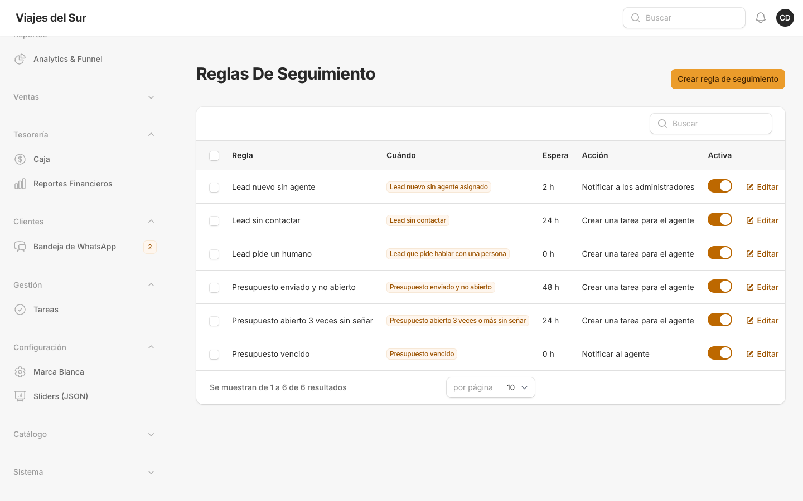

**Tareas:** tu agenda. Tienen título, descripción, fecha y hora, y se asocian a la consulta o al expediente. Las que crea el sistema aparecen ahí con vencimiento de hoy; marcalas como completadas al terminar.

Además, todos los días a las 9:00 recibís avisos de tareas vencidas y de presupuestos por vencer.

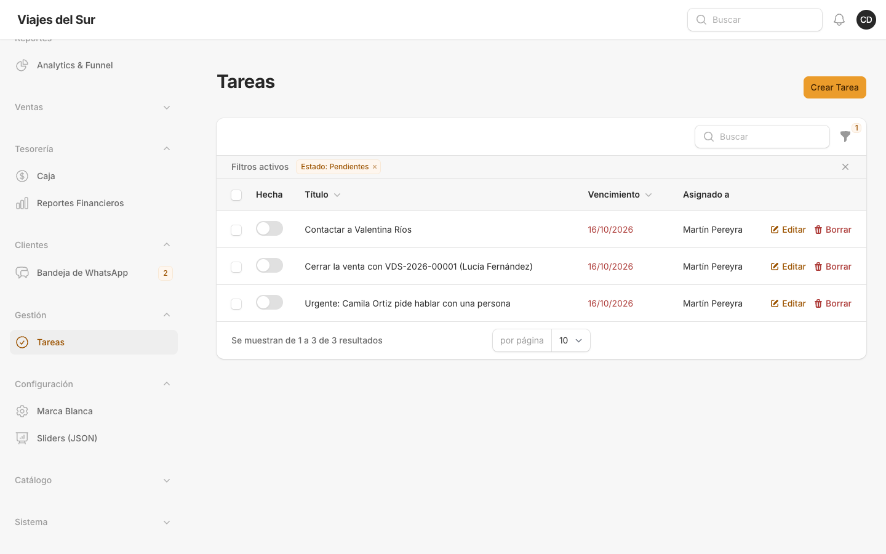

## 12. Bandeja de mensajes y bot recepcionista

*Menú: **Chat → Bandeja de mensajes***, ***Chat → Bot recepcionista*** y ***Chat → Avisos*** ⚙️ *Requiere conectar al menos un canal (ver Guía de administración)*

Los mensajes que tus clientes mandan por **WhatsApp**, **Instagram** y **Messenger** entran al sistema como consultas y se ven todos juntos en la bandeja, con las conversaciones a la izquierda y el chat a la derecha.

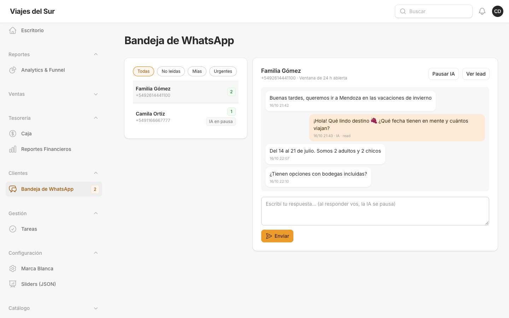

### Cómo llega un mensaje

1. El sistema reconoce o crea al cliente: en WhatsApp por su **teléfono** (en cualquier formato) y en Instagram o Messenger por su cuenta. Abre una consulta con el canal de origen.
2. Si todavía no lo atiende nadie, responde **el bot recepcionista** (si está encendido) o el **asistente anterior** (si no).
3. Cuando hace falta una persona, la consulta pasa a "atención requerida" y el equipo recibe un **aviso**. Con el bot recepcionista, además, la consulta se marca como **caliente**.
4. Desde la bandeja respondés vos. **Al responder, el bot se pausa** en esa conversación por las horas que configuraste (12 por defecto) y la consulta pasa a *En curso*.

> **WhatsApp en el celular y en el sistema a la vez.** Si la agencia conectó WhatsApp a través de **Zernio**, el número sigue funcionando en la app **WhatsApp Business** del celular. Lo que el equipo escribe desde el celular también aparece en la bandeja (marcado como **Celular**) y el bot se corre igual que si hubieras respondido desde el sistema.

### En la pantalla

- **Canales:** *Todos los canales*, *WhatsApp*, *Instagram* o *Messenger*. Si la agencia tiene varios números o cuentas, también podés elegir uno.
- **Filtros:** *Todas*, *No leídas*, *Mías* y *Urgentes*. El menú muestra un globito con las no leídas y la pantalla se actualiza sola cada pocos segundos.
- **Pausar IA / Reanudar IA** y **Ver lead**.
- Quién escribió cada mensaje: **IA**, **Equipo** o **Celular**, y su estado: enviado, entregado, leído o fallido.
- Si el bot mandó **botones de respuesta**, se ven debajo del mensaje como etiquetas. Si se mandó un **PDF**, aparece el adjunto con un link para abrirlo.

### La regla de las 24 horas (de Meta, no nuestra)

Podés escribir libremente solo hasta **24 horas después del último mensaje del cliente**.

- **WhatsApp:** pasado ese plazo, solo se pueden enviar **plantillas aprobadas**. La pantalla te muestra un selector de plantilla (por ejemplo "seguimiento de viaje") y los campos para completarla. Las plantillas se cargan en *Sistema → Plantillas de WhatsApp* con el nombre exacto que aprobó Meta.
- **Instagram y Messenger:** no hay plantillas. Si la cuenta tiene activado *"Permitir que una persona responda hasta 7 días después"*, una persona (nunca el bot) puede seguir respondiendo hasta 7 días. Si no, hay que esperar a que el cliente vuelva a escribir.

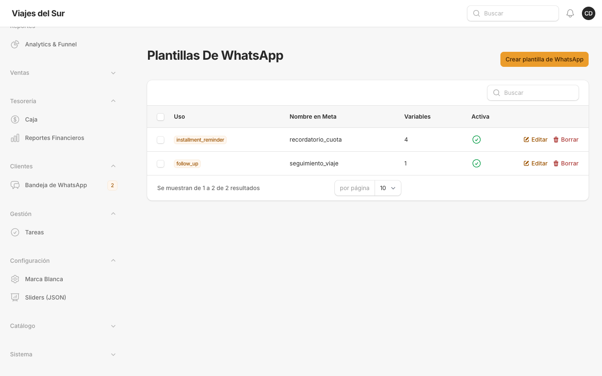

### El bot recepcionista

*Menú: **Chat → Bot recepcionista*** (solo administradores)

Es el asistente que atiende los primeros mensajes de **WhatsApp, Instagram y Messenger**. Su trabajo es **resolver dudas generales y juntar los datos del viaje** para que el equipo mande la cotización oficial:

- destino, fechas (desde, hasta y si son flexibles), presupuesto en dólares,
- adultos, menores y sus edades,
- pasaporte y visa (solo si el viaje es al exterior), si lo quiere todo incluido y la ciudad de salida.

Pregunta de a una o dos cosas por mensaje, no repite lo que ya sabe, y **se acuerda de lo que no cambia entre viajes**: la próxima vez solo confirma (*"¿seguís teniendo el pasaporte vigente?"*).

**Botones de respuesta en WhatsApp.** Cuando la pregunta tiene respuestas cerradas (*Sí / No*, *Todo incluido / Solo hotel*), el bot la manda con **hasta 3 botones** para que el cliente conteste con un toque. El toque cuenta como si el cliente lo hubiera escrito. En Instagram y Messenger las mismas opciones aparecen escritas como lista.

**Reglas fijas, que nadie puede cambiar:**

- Nunca da **formas de pago, datos bancarios, precios finales ni disponibilidad confirmada**. Si una respuesta los incluye, el sistema la bloquea, manda un mensaje de derivación y avisa al equipo.
- Solo habla de viajes y de la agencia.
- No inventa. Si no sabe, si le piden una persona o si quieren reservar o pagar, **deriva**.
- Lo que escribe el cliente son datos, nunca órdenes.

**Lo que configurás:**

| Sección | Qué ajustás |
|---|---|
| **Estado** | El interruptor que lo enciende. Apagado, los canales siguen con el asistente anterior. |
| **Qué dice** | *Instrucciones* (tono, qué preguntar, preguntas frecuentes) y *Cuándo derivar a una persona*, en lenguaje común. |
| **Promociones vigentes** | Título, texto, canal donde se publicó y fechas. El bot las explica tal cual, solo mientras están vigentes. |
| **Horario y topes** | Días y horario del equipo (decide cuándo se muestran los avisos; el bot responde siempre), **horas de pausa** después de una respuesta humana y **máximo de respuestas por conversación por día**. |
| **Proveedor de IA** | Es la misma IA de toda la agencia. Incluye un **límite de gasto mensual en dólares**: al llegar, el bot deja de responder, avisa al equipo y le dice al cliente que una persona se va a comunicar. |

**Probar bot:** el botón abre un chat interno para escribirle como si fueras un cliente. Usa la misma IA y las mismas reglas, pero **no guarda ni envía nada**. Ves los datos que fue anotando, los botones que propone y los avisos que hubiera dado. Probalo siempre antes de encenderlo.

### Avisos del bot

*Menú: **Chat → Avisos***

Es la lista de cosas que el bot te pide revisar:

| Aviso | Qué hacer |
|---|---|
| **Derivación a una persona** | El cliente necesita a alguien (pidió hablar, quiere pagar, el bot no supo responder). Abrí la conversación y respondé. |
| **Datos completos: lista para cotizar** | El bot juntó todo lo necesario. Armá el presupuesto. |
| **Verificar consulta nueva** | El cliente habló de un viaje distinto y el bot abrió una consulta *Por verificar*. Elegí **Confirmar como nueva** o **Unir a la consulta de…** (pasa los mensajes y los datos a la otra y borra la duplicada). |

Cada aviso tiene **Ver conversación** y **Marcar leído**.

## 13. Ideas de Viaje y el Importador

### Ideas de Viaje (el catálogo)

*Menú: **Catálogo → Ideas de Viaje***

Son los paquetes que se muestran en la web. Cada idea tiene pestañas:

| Pestaña | Para qué |
|---|---|
| **Idea Rápida** | Título, destino, noches, precio desde, moneda, base de precio, etiquetas, resumen, imagen de portada (obligatoria) y el interruptor **Activa** (publicada o no). |
| **Políticas y Precios** | Suplemento single, reducción en triple, políticas de niños, temporadas con precio. |
| **Descripción Extendida** | Texto largo. |
| **Itinerario** | Día por día (podés pedirle un borrador a la IA). |
| **Costos y Servicios** | Servicios con proveedor, costo y venta, para armar presupuestos rápido. |
| **Imágenes** | Galería. |
| **Incluye / No Incluye** | Una línea por ítem. |

Desde la lista de ideas podés **generar un presupuesto** para un cliente a partir de la idea.

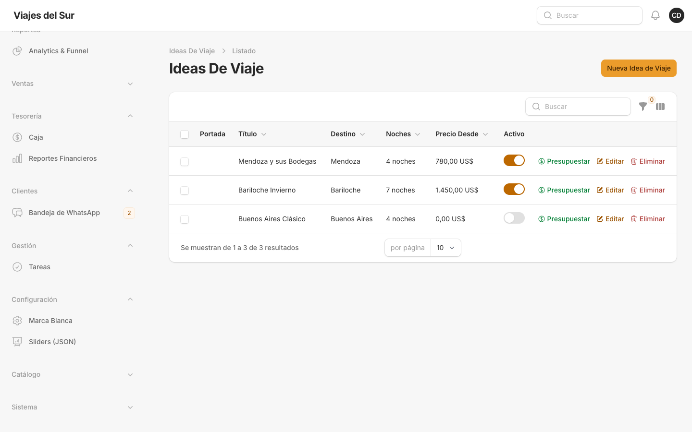

### Importar una idea desde un link, texto o PDF

*Menú: **Catálogo → Importar Ideas de Viaje*** ⚙️ *Requiere la IA configurada*

Sirve para no tipear: le pasás la oferta de un operador y arma un **borrador** que vos revisás.

1. **Nueva importación** y elegí la fuente: **un link**, **texto pegado** o **un PDF** (hasta 10 MB; los PDF escaneados también sirven).

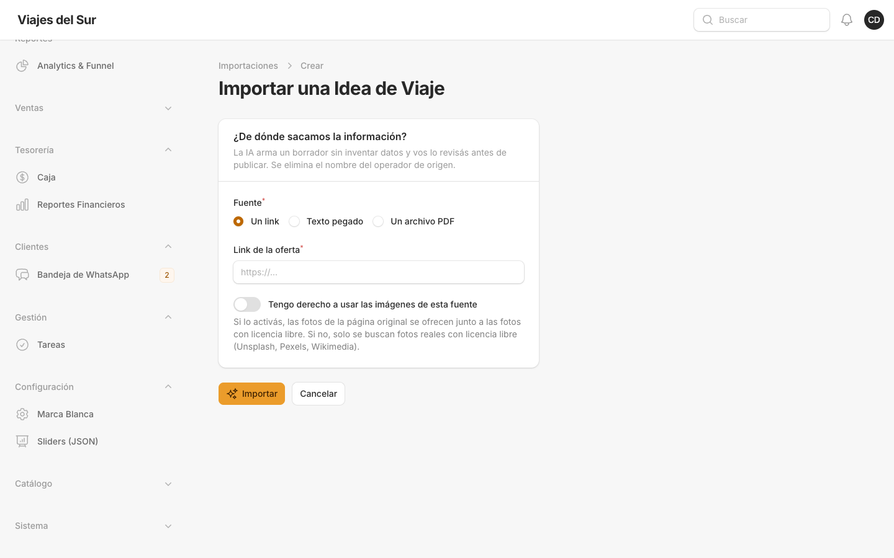

2. Si es un link, podés tildar *"Tengo derecho a usar las imágenes de esta fuente"*. Si no lo tildás, las fotos de la página original no se usan.
3. Apretá **Importar**. En menos de un minuto (puede tardar un poco más si es largo) pasa a *Listo para revisar*.
4. En la pantalla de revisión ves:
   - los **avisos** (por ejemplo "la fuente no indicaba un precio" o "ya existe una idea parecida"),
   - los datos que la IA **no tenía claros** (hay que revisarlos con atención),
   - el **borrador** (título, destino, noches, precio, resumen, cantidad de días de itinerario),
   - el **texto original** para comparar,
   - las **fotos sugeridas**.
5. **Fotos:** son **reales, con licencia libre**, de Unsplash, Pexels y Wikimedia Commons (nunca generadas por IA ni sacadas de Google). Marcás las que querés, elegís la **portada** y apretás *Usar las imágenes elegidas*. Se guarda el **crédito del autor** y se muestra en la página del paquete.
6. **Editar borrador** para corregir lo que haga falta (es la misma pantalla de Ideas de Viaje).
7. **Publicar** (pide confirmación). Para publicar tiene que tener **portada, precio y resumen**.
8. Si no sirve: **Descartar** (elimina el borrador).

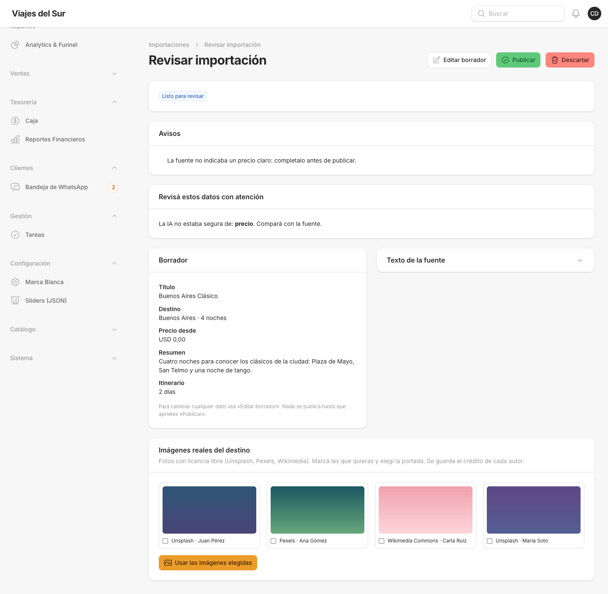

**Qué hace la IA y qué no**

- **No inventa datos:** lo que no figura en la fuente queda vacío.
- Reescribe los textos con la voz de tu agencia ("vos", tono cálido).
- **Quita el nombre, teléfono y datos del operador de origen.**
- No completa costos ni proveedores: eso lo cargás vos.

> Siempre revisá antes de publicar: la IA puede equivocarse, y vos sos quien firma la propuesta.

## 14. La vidriera web y sus formularios

*Menú: **Catálogo → Sliders** (banners) y **Configuración → Marca Blanca** (todo lo visual)*

Lo que ve el público:

- **Inicio** con banners (sliders) y formulario de consulta.

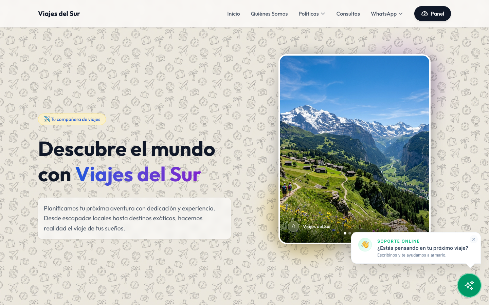

- **Ideas de Viaje** (el catálogo), con el detalle de cada paquete y su formulario.
- **Chat** con el asistente virtual ⚙️. Después de los primeros mensajes, el chat ofrece botones para **seguir la charla por WhatsApp, Instagram o Messenger**, poniendo primero la red de la que vino la visita. La conversación continúa en la misma consulta, con todo lo que ya se habló.
- **Cotizador** (/cotizar): la persona elige destino, fechas, pasajeros y deja sus datos en 3 pasos.
- **Página de presupuesto** (la del link privado).
- Páginas de quiénes somos, privacidad y cookies.

Cualquier consulta que llega por estos medios aparece en **Consultas**. Para evitar abusos, el chat limita la cantidad de mensajes por minuto y los formularios tienen una trampa invisible contra robots.

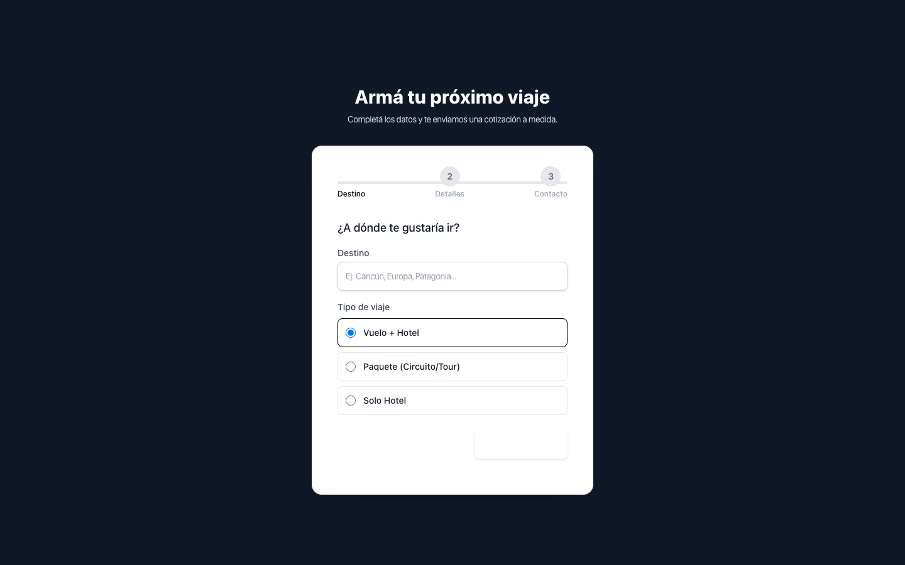

## 15. Portal del cliente

Los clientes pueden entrar a su propio espacio (dirección `/portal`) para ver sus viajes y consultas.

Para entrar escriben su **email o teléfono** y, en lugar de una contraseña, su **DNI o pasaporte**, tal como figura en su ficha de cliente. Por eso conviene cargar bien esos datos en *Ventas → Clientes*. Después de varios intentos fallidos, el portal hace esperar unos minutos antes de dejar probar de nuevo.

## 16. Configuración de la agencia

*Menú: **Configuración → Marca Blanca*** (solo administradores)

| Pestaña | Qué configurás |
|---|---|
| **Identidad y Frontend** | Nombre de la empresa, logo e isotipo, **nombre del asistente virtual**, **proveedor de IA** (Google Gemini, OpenAI, Groq u otro compatible) **y su clave**, colores del sitio público, SEO. La clave guardada nunca se vuelve a mostrar completa: solo sus últimos 4 caracteres. |
| **Panel de Control (Backend)** | Colores del panel de administración. |
| **Contacto y Redes** | Email, teléfono, dirección, mapa, redes sociales (los links de WhatsApp también se usan en el chat). |
| **Analítica y Scripts** | Códigos externos (Google Analytics, píxeles). |
| **Legal y Acuerdos** | La plantilla del contrato. Variables automáticas: `[NOMBRE_CLIENTE]`, `[DNI_CLIENTE]`, `[EMAIL_CLIENTE]`, `[TELEFONO_CLIENTE]`, `[TOTAL_VIAJE]`, `[DESTINO]`, `[FECHA_VIAJE]`. |
| **Finanzas** | **Dólar por defecto**, **prefijo** de los números de expediente, **asignación automática** de consultas, días mínimos entre la última cuota y el viaje, **cómo pagar** (datos bancarios que ve el cliente) y los **textos de los recordatorios** (`[NOMBRE]`, `[CUOTA]`, `[MONTO]`, `[VENCIMIENTO]`, `[EXPEDIENTE]`). |
| **Integraciones** | Claves gratuitas de **Unsplash** y **Pexels** para las fotos del importador. |
| **Mantenimiento** | Modo mantenimiento (oculta el sitio al público; el panel sigue funcionando). |

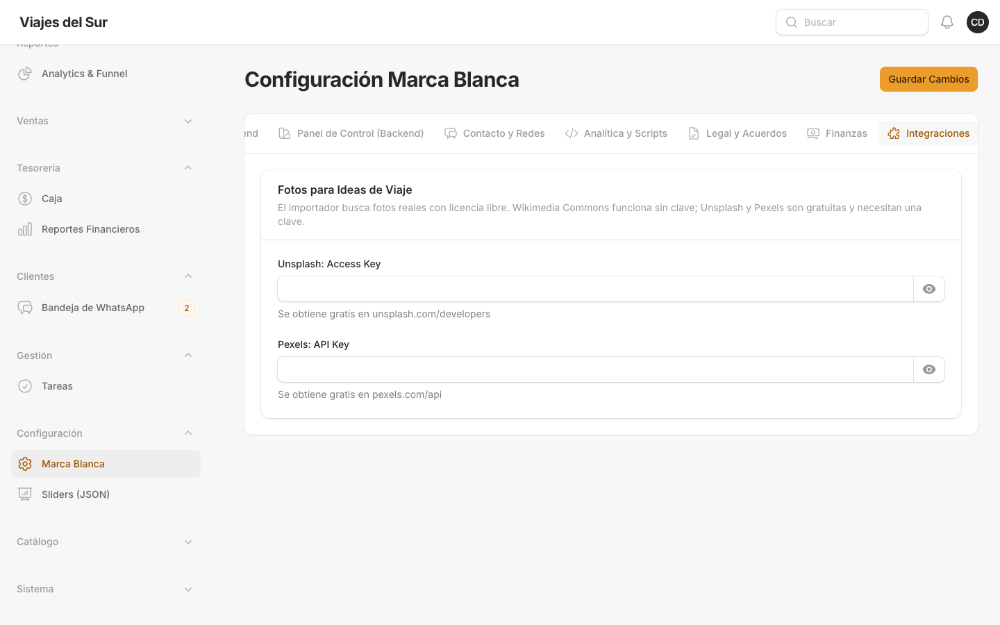

Recordá apretar **Guardar Cambios** (arriba a la derecha). El botón **Guardar y probar IA** guarda y comprueba que el proveedor, la clave y el modelo respondan.

> Lo del bot recepcionista se configura aparte, en *Chat → Bot recepcionista* (sección 12).

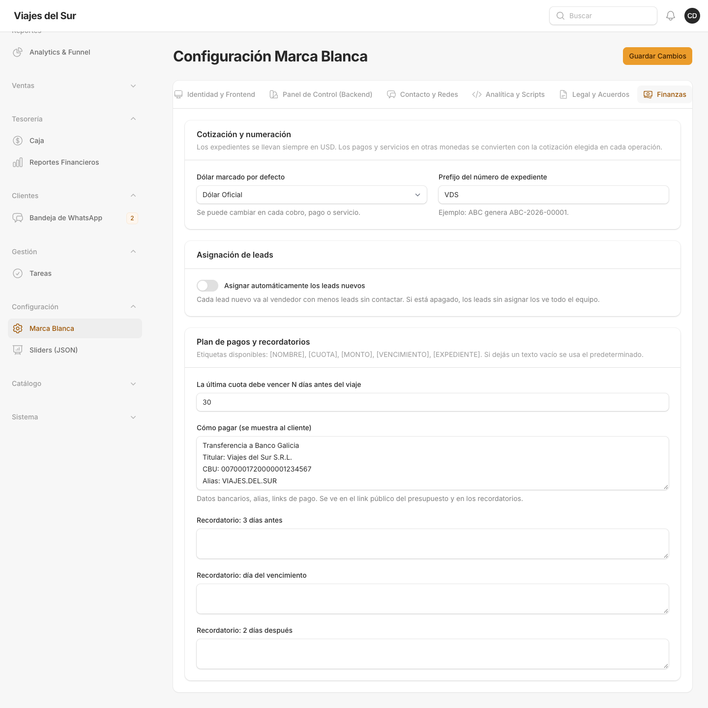

## 17. Reportes

- **Tesorería → Reportes Financieros** *(Finanzas y administradores)*: balance anual mes a mes (ingresos, egresos, resultado) **en USD** y descarga en PDF. Se calcula con la **fecha real del movimiento**.

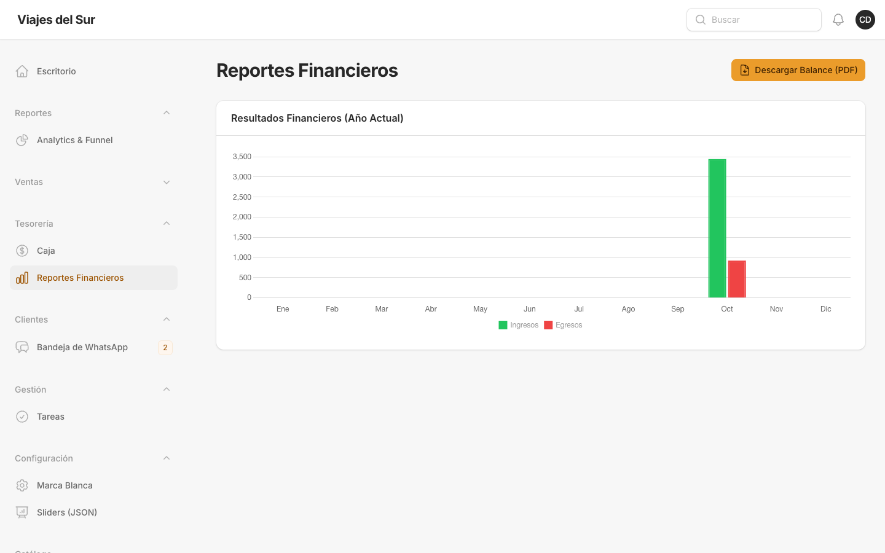

- **Reportes → Analytics & Funnel:** embudo de consultas, origen de las consultas, productos más vendidos.

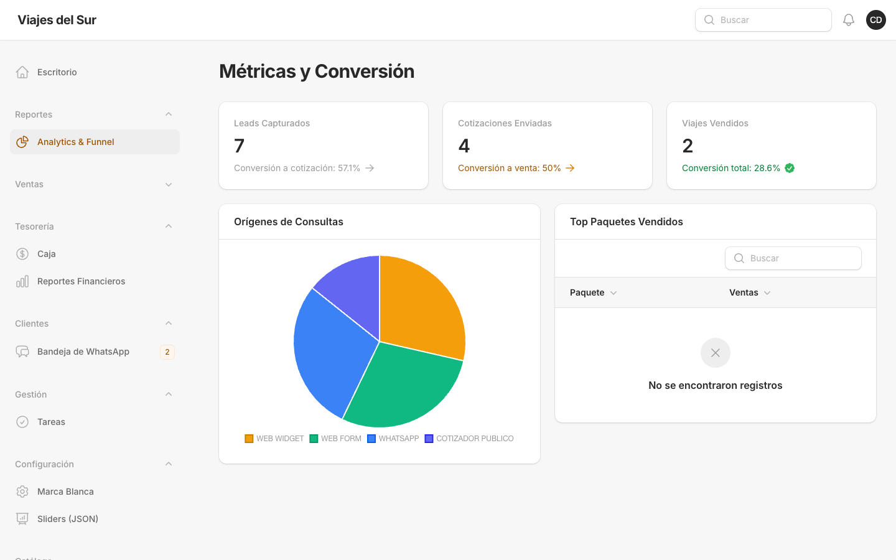

- **Escritorio:** KPI, cobranzas y velocidad de respuesta (sección 3).

## 18. Glosario y preguntas frecuentes

**Lead / Consulta:** persona interesada que todavía no compró.
**Expediente / File:** el viaje de un cliente (desde presupuesto hasta emitido).
**Seña:** primer pago que "reserva" el viaje.
**Cuota:** cada pago del plan.
**Imputar:** decidir a qué cuota corresponde un cobro.
**Cotización:** cuántos pesos vale un dólar en el momento de la operación.
**Ventana de 24 horas:** plazo de WhatsApp para responder libremente.
**Plantilla de WhatsApp:** mensaje pre-aprobado por Meta para escribir fuera de la ventana.
**Bot recepcionista:** el asistente que atiende los primeros mensajes de WhatsApp, Instagram y Messenger y junta los datos del viaje.
**Derivar:** cuando el bot pasa la conversación a una persona del equipo.
**Botones de respuesta:** hasta 3 opciones que el cliente toca en WhatsApp en lugar de escribir.
**Tablero:** la vista de consultas en columnas por estado, para mover cada consulta de etapa arrastrándola.

**¿Por qué el total de un viaje en pesos cambió respecto de antes?**
Porque ahora cada servicio en pesos se convierte a dólares con su cotización. Antes un servicio en pesos podía sumarse como si fueran dólares.

**¿Puedo cargar un cobro en pesos si el viaje está en dólares?**
Sí. Elegí pesos y la cotización del día: el sistema calcula cuántos dólares cubre.

**¿Qué pasa si el cliente paga más que la cuota?**
El excedente se aplica a las siguientes cuotas.

**¿Por qué no me llegan los mails o las respuestas automáticas al instante?**
Salen en una cola que se procesa cada minuto. Si pasan varios minutos, revisá el aviso del cron en el Escritorio.

**La IA respondió algo incorrecto.**
Corregilo desde la bandeja o el chat de la consulta y pausá la IA en esa conversación. Si usás el bot recepcionista, ajustá sus *Instrucciones* en *Chat → Bot recepcionista* y probalo con **Probar bot** antes de volver a encenderlo.

**¿Por qué el bot no le respondió a un cliente?**
Puede estar en pausa porque alguien del equipo respondió hace poco (también desde el celular): en ese caso no hay aviso, porque ya hay una persona atendiendo. También puede haber llegado al máximo de respuestas del día para esa conversación o al límite de gasto mensual: en esos dos casos queda un aviso en *Chat → Avisos*.

**¿Por qué no aparece "Enviar PDF por WhatsApp" en un expediente?**
El cliente no tiene una conversación de WhatsApp abierta o WhatsApp no está conectado. Si el botón aparece en gris, pasaron más de 24 horas desde su último mensaje.

**¿En qué orden atiendo las consultas?**
En el que te muestra la lista: ya viene ordenada por urgencia. Empezá por la pestaña **Para hoy** y vaciala de arriba hacia abajo.

**¿Cómo evito que se mezclen clientes?**
El sistema identifica por email o teléfono. Si alguien escribe sin datos, queda como una consulta aparte que podés completar a mano.
