# Tutoriales paso a paso

Cada tutorial dice **cuánto lleva**, **qué necesitás** y **cómo saber que salió bien**. Hacelos en orden la primera vez; después usalos como consulta.

> 💡 Antes de empezar con datos reales, practicá con un cliente de prueba (por ejemplo "Cliente Prueba"). Podés borrarlo después.

**Índice**

1. Dejar la agencia configurada (primer día)
2. De la consulta al presupuesto enviado
3. Cargar servicios en dólares y en pesos
4. Armar el plan de pagos y cobrar la seña
5. Cobrar una cuota en pesos y pagar a un proveedor
6. Seguimiento: tu cola del día, el tablero y las reglas automáticas
7. Atender WhatsApp, Instagram y Messenger desde la bandeja
8. Importar una idea de viaje
9. Publicar una idea y cuidar la vidriera
10. Cierre del mes
11. Sumar a una persona al equipo
12. Qué hacer si…
13. Configurar y probar el bot recepcionista
14. Mandar el presupuesto en PDF por WhatsApp
15. Controlar a los pasajeros que viajan pronto

---

## Tutorial 1 — Dejar la agencia configurada (primer día)

⏱ 20 minutos · 👤 Administrador

1. Entrá a **Configuración → Marca Blanca**.
2. Pestaña **Identidad y Frontend:** cargá el nombre de la empresa, el logo y el isotipo, y elegí los colores. Poné el nombre que querés para el asistente virtual (por ejemplo "Luna").
3. Pestaña **Contacto y Redes:** completá email, teléfono, dirección y tus redes. Si agregás tu **WhatsApp**, el chat y los presupuestos usan ese número.
4. Pestaña **Legal y Acuerdos:** revisá el contrato. Podés usar las variables `[NOMBRE_CLIENTE]`, `[TOTAL_VIAJE]`, `[DESTINO]`… que se reemplazan solas en cada PDF.
5. Pestaña **Finanzas:**
   - **Dólar marcado por defecto:** elegí *Oficial*, *MEP* o *Tarjeta* (el que uses para cobrar).
   - **Prefijo del número de expediente:** por ejemplo `ABC` → `ABC-2026-00001`.
   - **Cómo pagar:** escribí tus datos bancarios, alias y links de pago. Es lo que verá el cliente.
   - Dejá los demás valores y, si querés, personalizá los textos de los recordatorios de pago.
6. Apretá **Guardar Cambios**.

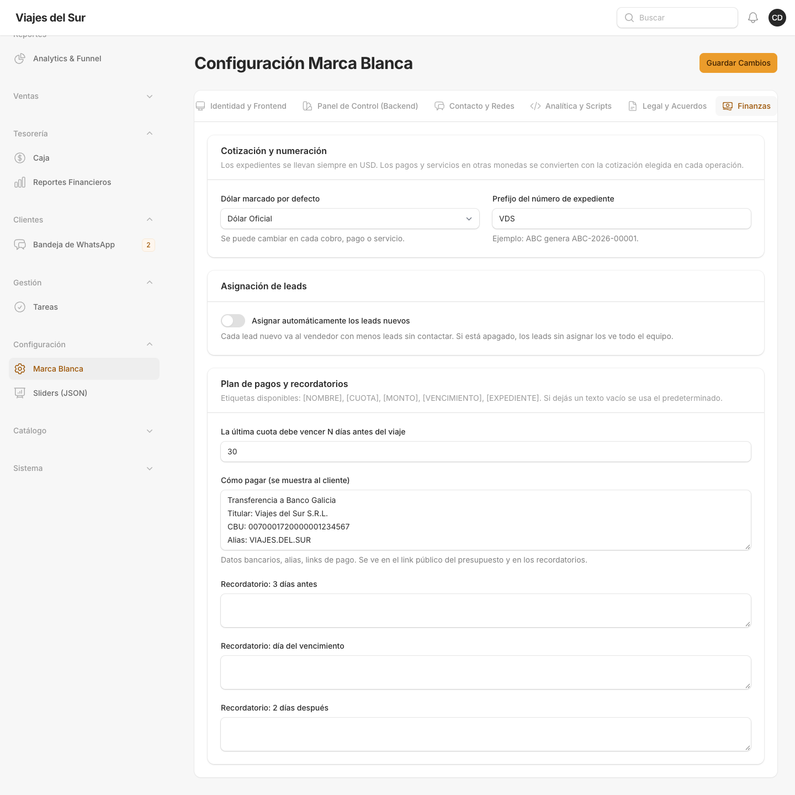

✅ **Salió bien si…** abrís el sitio público y ves tu logo y colores.

---

## Tutorial 2 — De la consulta al presupuesto enviado

⏱ 15 minutos · 👤 Ventas

**Objetivo:** convertir una consulta en un presupuesto y mandárselo al cliente.

1. Entrá a **Ventas → Consultas**. La lista abre en la pestaña **Para hoy**, con lo más urgente arriba. Si no hay ninguna, creá una de prueba desde el formulario de la web o con el botón **Nuevo**.

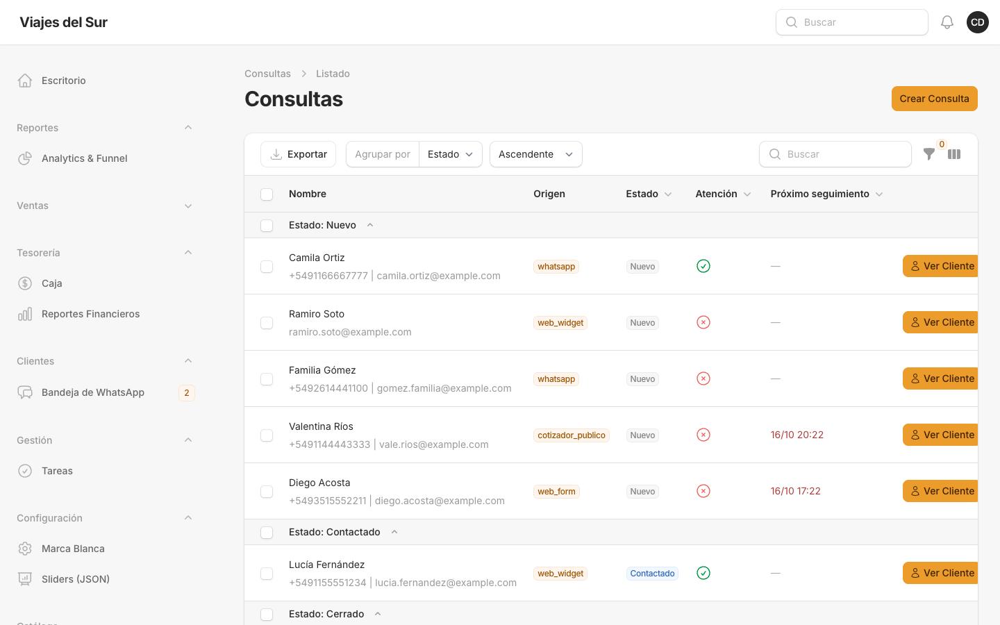

2. En la fila de la consulta, abrí el menú **⋯ → Crear Expediente**. Completá la cantidad de adultos y niños.
3. Se abre el expediente nuevo con los datos de la consulta (destino, pasajeros, nombre del cliente). Revisá **Titular**, **Fecha de salida**, **Noches** y **Vencimiento del presupuesto**.

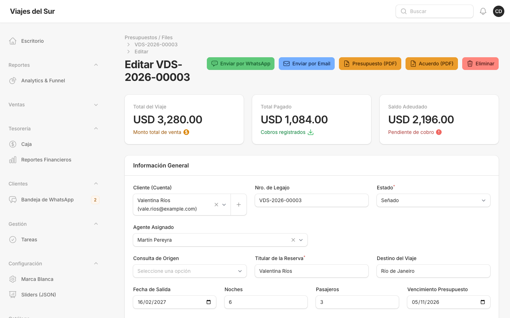

4. En **Detalle de Servicios**, agregá cada servicio (ver Tutorial 3).
5. Mirá **Liquidación / Resumen:** el sistema calcula el total y tu rentabilidad en dólares.
6. En **Estado** dejalo en **Presupuesto** y guardá.
7. Arriba a la derecha:
   - **Presupuesto (PDF)** para revisar cómo lo ve el cliente, y
   - **Enviar por Email**, **Enviar PDF por WhatsApp** (Tutorial 14) o **Abrir en WhatsApp**, o **Ver Link Público** para copiar el link.

✅ **Salió bien si…** en la pestaña **Actividad** del expediente figura el envío y la consulta deja de figurar como "sin contactar" para el seguimiento automático. Para reflejarlo en el estado, pasala a *Cotizada* desde **Editar** o arrastrándola en el **Tablero de consultas**.

💡 Cuando el cliente abra el link, en **Actividad** vas a ver *"El cliente abrió el presupuesto por primera vez"*.

---

## Tutorial 3 — Cargar servicios en dólares y en pesos

⏱ 10 minutos · 👤 Ventas / Finanzas

**Ejemplo:** un hotel de USD 800 y un traslado de $ 150.000 (a pagar en pesos).

1. En el expediente, sección **Detalle de Servicios** → **Agregar servicio**.
2. **Hotel:**
   - Tipo de servicio: *Hotel* · Descripción: "5 noches en Bariloche".
   - Proveedor: elegí o creá uno.
   - Moneda: **USD** (no pide cotización).
   - Costo neto: `650` · Precio de venta: `800`.
3. **Traslado:**
   - Moneda: **Pesos Argentinos**.
   - En **Cotización** aparece el selector con el valor del día de cada dólar. Elegí **Oficial** (o *MEP*, *Tarjeta*, o *Personalizado* para escribir el tuyo).
   - El campo **ARS por 1 USD** se completa solo. Si usás *Personalizado*, escribilo (por ejemplo `1500`).
   - Costo neto: `100000` · Precio de venta: `150000`.
4. Mirá la **Liquidación:** el traslado suma USD 100 (150.000 ÷ 1.500) al total de venta. El total del viaje es **USD 900**.

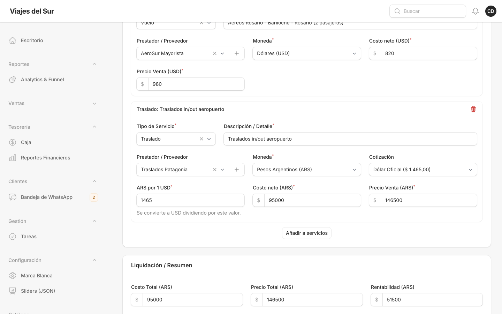

✅ **Salió bien si…** el total en USD coincide con tu cuenta (dólares + pesos ÷ cotización).

⚠️ Si no te deja guardar un servicio en pesos, falta la cotización: elegila del selector o escribila.

---

## Tutorial 4 — Armar el plan de pagos y cobrar la seña

⏱ 15 minutos · 👤 Ventas / Finanzas

**Objetivo:** dejar acordados seña y cuotas, y cobrar la primera.

1. Abrí el expediente (con el total ya cargado) y andá a la pestaña **Plan de Pagos**.
2. Apretá **Generar plan** y completá:
   - **Seña (%):** `30`
   - **Cantidad de cuotas del saldo:** `3`
   - **Primer vencimiento de cuota:** dentro de un mes
   - **Frecuencia:** Mensual

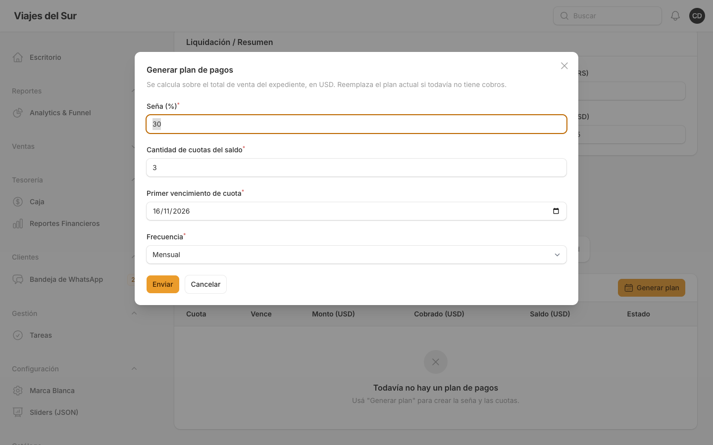

3. Confirmá. Para un viaje de USD 900 queda:

   | Cuota | Monto (USD) |
   |---|---|
   | Seña | 270,00 |
   | Cuota 1/3 | 210,00 |
   | Cuota 2/3 | 210,00 |
   | Cuota 3/3 | 210,00 |

   > Si la última cuota vence demasiado cerca del viaje, el sistema te avisa hasta qué fecha puede llegar.

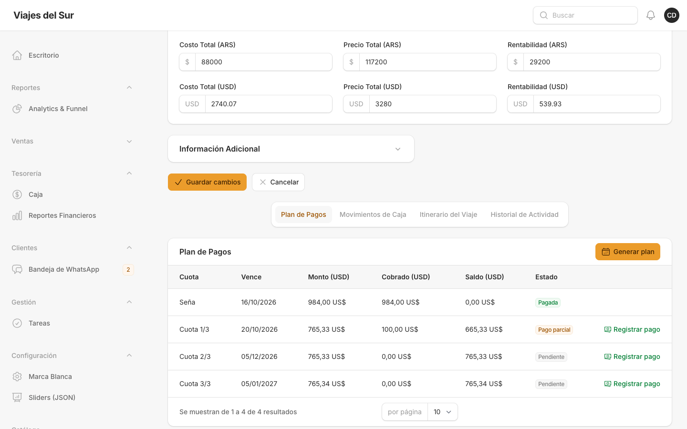

4. El cliente ya puede ver el plan en el **link público** del presupuesto (sección "Tu plan de pagos").
5. Cuando el cliente pague la seña, en la fila **Seña** apretá **Registrar pago**:
   - Moneda: USD · Monto: `270` · Método: Transferencia · Fecha de hoy.

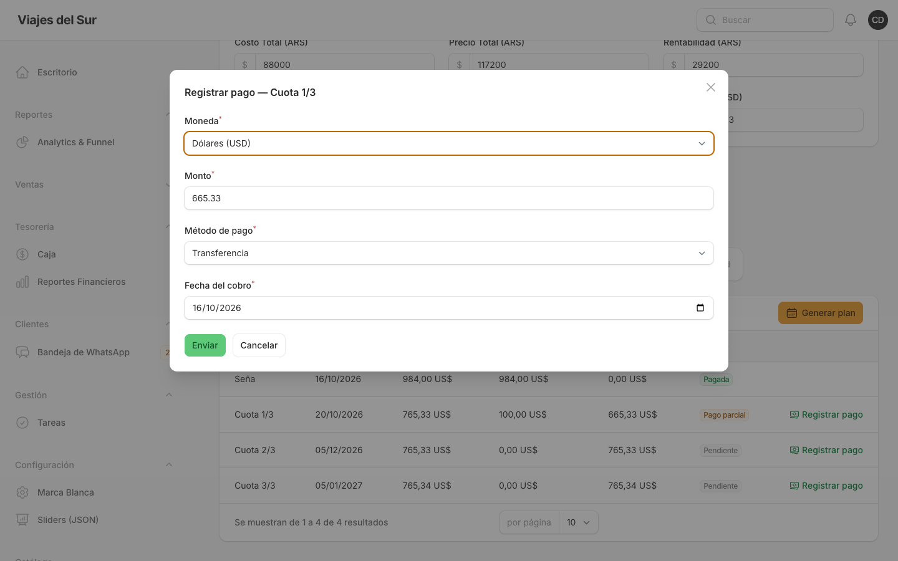

6. Guardá.

✅ **Salió bien si…** la seña figura como **Pagada**, el expediente pasó solo a **Señado**, y el saldo adeudado bajó a USD 630.

---

## Tutorial 5 — Cobrar una cuota en pesos y pagar a un proveedor

⏱ 15 minutos · 👤 Finanzas

### A) El cliente paga la Cuota 1 en pesos

1. **Plan de Pagos** → fila **Cuota 1/3** → **Registrar pago**.
2. Moneda: **Pesos Argentinos**. El monto sugerido ya está convertido al dólar del día.
3. Verificá la cotización (podés cambiarla: *Oficial*, *MEP*, *Tarjeta* o *Personalizado*) y el monto en pesos que **realmente** te transfirió el cliente.
4. Elegí método y fecha. Guardá.

El sistema calcula a cuántos dólares equivale lo cobrado:
- Si el cliente transfirió lo justo, la cuota queda **Pagada**.
- Si transfirió menos, queda **Pago parcial** con el saldo restante.
- Si transfirió de más, el excedente se aplica a la cuota siguiente.

### B) Descargar el recibo

**Tesorería → Caja** → en la fila del cobro, **Recibo** (PDF). Muestra el método, la cotización y a qué cuota se imputó.

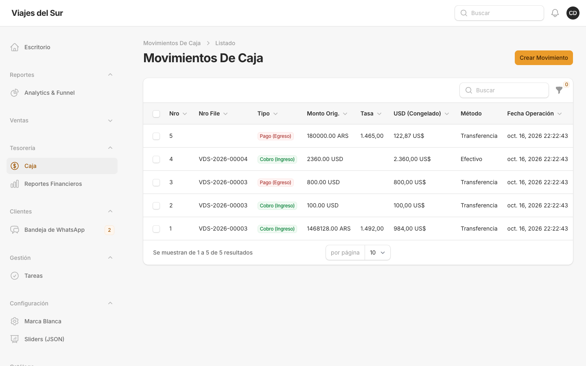

### C) Pagarle a un proveedor

1. **Tesorería → Caja → Nueva transacción**.
2. Tipo: **Pago (Egreso)** · método y cuenta financiera.
3. Categoría: *Pago a Proveedor* · Expediente: el del viaje · Proveedor: el hotel.
4. Moneda y monto (si es en pesos, elegí cotización).
5. Adjuntá el comprobante y guardá.

✅ **Salió bien si…** en **Sistema → Proveedores** el saldo del proveedor bajó.

---

## Tutorial 6 — Seguimiento: tu cola del día, el tablero y las reglas automáticas

⏱ 15 minutos · 👤 Ventas (cola y tablero) / Administrador (reglas)

### Empezar el día por la pestaña "Para hoy"

1. Entrá a **Ventas → Consultas**. Abre en **Para hoy**: las consultas que piden una persona, las nuevas y las que tienen seguimiento hasta hoy.
2. Trabajalas **de arriba hacia abajo**. La lista ya está ordenada: primero las que piden una persona, después los seguimientos vencidos, después las calientes y al final el resto por fecha de seguimiento.
3. En cada una: respondé o llamá, y después **Editar** para cambiar el estado o poner la fecha del **próximo seguimiento**.
4. Mirá las otras pestañas cuando termines: **Seguimiento vencido** debería quedar en cero, y en **Sin asignar** no debería quedar nada viejo.

### Revisar el embudo en el tablero (una vez por semana)

1. **Ventas → Tablero de consultas** (o **Ver tablero** desde la lista).
2. Mirá cuántas consultas hay en cada columna: *Nueva*, *En curso*, *Cotizada*, *Reservada*.
3. **Arrastrá** cada tarjeta a la columna que corresponda. Por ejemplo, de *En curso* a *Cotizada* cuando ya mandaste el presupuesto.
4. Tildá **Solo mis consultas** para ver solo las tuyas, o **Solo calientes** para enfocarte en las que están por cerrar.

💡 Una tarjeta con franja roja es caliente; una fecha en rojo es un seguimiento vencido.

### Ver lo que el sistema te dejó para hacer

1. **Gestión → Tareas** (o la tarjeta de tareas del Escritorio).
2. Vas a ver tareas como *"Contactar a Lucía"*, *"Llamar a… (no abrió el presupuesto)"* o *"Cerrar la venta con…"*.
3. Cuando la hagas, marcala como completada.

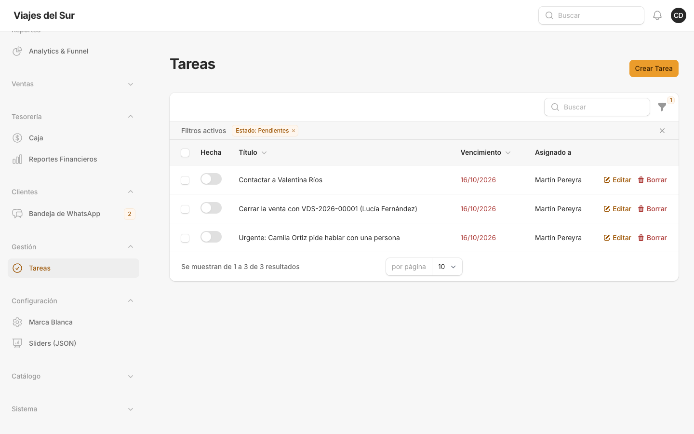

### Ajustar las reglas

1. **Sistema → Seguimiento automático**.
2. Para cada regla podés:
   - **Prenderla o apagarla** con el interruptor,
   - cambiar **cuántas horas espera**,
   - elegir **qué hace** (crear tarea, avisar al vendedor o avisar a los administradores).

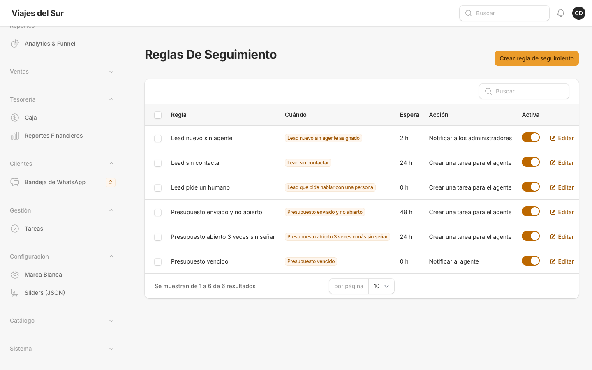

3. Guardá. Los cambios valen desde la próxima revisión (que ocurre cada hora).

### Que las consultas se repartan solas (opcional)

**Configuración → Finanzas → Asignación de leads** → activá *Asignar automáticamente los leads nuevos*. Cada consulta nueva va al vendedor con menos pendientes.

✅ **Salió bien si…** al terminar el día la pestaña **Seguimiento vencido** está vacía, y al otro día de una consulta sin atender aparece una tarea para el vendedor.

---

## Tutorial 7 — Atender WhatsApp, Instagram y Messenger desde la bandeja

⏱ 10 minutos · 👤 Ventas · ⚙️ *Requiere al menos un canal conectado (ver Guía de administración)*

1. Entrá a **Chat → Bandeja de mensajes**. Un globito con número en el menú indica cuántas conversaciones tienen mensajes sin leer.
2. Arriba elegí el canal (**Todos los canales**, *WhatsApp*, *Instagram* o *Messenger*) y, si quieren, filtrá por **No leídas**, **Mías** o **Urgentes**.
3. Hacé clic en una conversación: se abre el chat y se marca como leída.

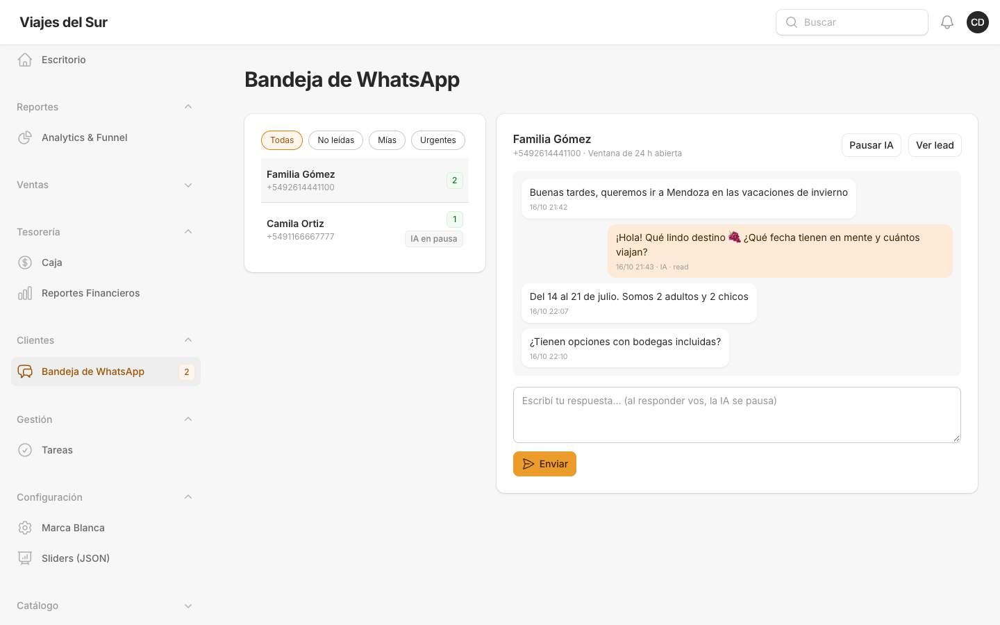

4. Mirá quién respondió cada mensaje: **IA** (el bot o el asistente), **Equipo** (desde el sistema) o **Celular** (desde la app WhatsApp Business, si la agencia usa esa opción). Si el bot mandó botones, los ves como etiquetas debajo de su mensaje.
5. Para responder, escribí abajo y apretá **Enviar**. **Desde ese momento el bot queda en pausa** en esa conversación y la consulta pasa a *En curso*.
6. ¿Querés que la IA retome? Apretá **Reanudar IA**.
7. **Ver lead** abre la ficha de la consulta para crear el expediente.

### Cuando pasaron más de 24 horas

- **WhatsApp:** la bandeja avisa *"Fuera de la ventana de 24 h: solo plantillas"*. Elegí una **plantilla** de la lista, completá las variables (nombre, destino…) y enviá. Si no ves plantillas, pedile al administrador que las cargue en *Sistema → Plantillas de WhatsApp*.
- **Instagram y Messenger:** si la cuenta lo permite, podés seguir respondiendo hasta 7 días. Si no, la bandeja te avisa que hay que esperar a que el cliente vuelva a escribir.

### Revisar los avisos del bot

1. **Chat → Avisos**.
2. *Derivación a una persona*: abrí la conversación con **Ver conversación** y respondé.
3. *Datos completos: lista para cotizar*: armá el presupuesto (Tutorial 2).
4. *Verificar consulta nueva*: si de verdad es otro viaje, **Confirmar como nueva**. Si es el mismo, **Unir a la consulta de…** y elegí la consulta abierta.
5. **Marcar leído** cuando lo resolviste.

✅ **Salió bien si…** el mensaje figura como *enviado* y luego *entregado/leído*, y no quedan avisos sin leer de días anteriores.

---

## Tutorial 8 — Importar una idea de viaje

⏱ 10 minutos · 👤 Ventas / Administrador · ⚙️ *Requiere la IA configurada*

**Objetivo:** convertir la oferta de un operador en una idea de tu catálogo sin tipear.

1. **Catálogo → Importar Ideas de Viaje → Nueva importación**.
2. Elegí la fuente:
   - **Un link:** pegá la dirección de la página de la oferta.
   - **Texto pegado:** copiá el programa y pegalo.
   - **Un PDF:** subí el archivo (hasta 10 MB).

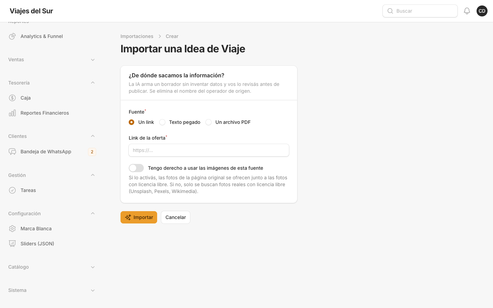

3. Si es un link y **tenés autorización** para usar sus fotos, tildá la casilla. Si no, dejala sin tildar.
4. Apretá **Importar**. Se abre la pantalla de revisión; esperá hasta que diga **Listo para revisar** (se actualiza sola).
5. Revisá:
   - **Avisos** (precio faltante, posible duplicado),
   - **"Revisá estos datos con atención"** (lo que la IA no tenía claro),
   - el **borrador** y, desplegando **Texto de la fuente**, el original para comparar.

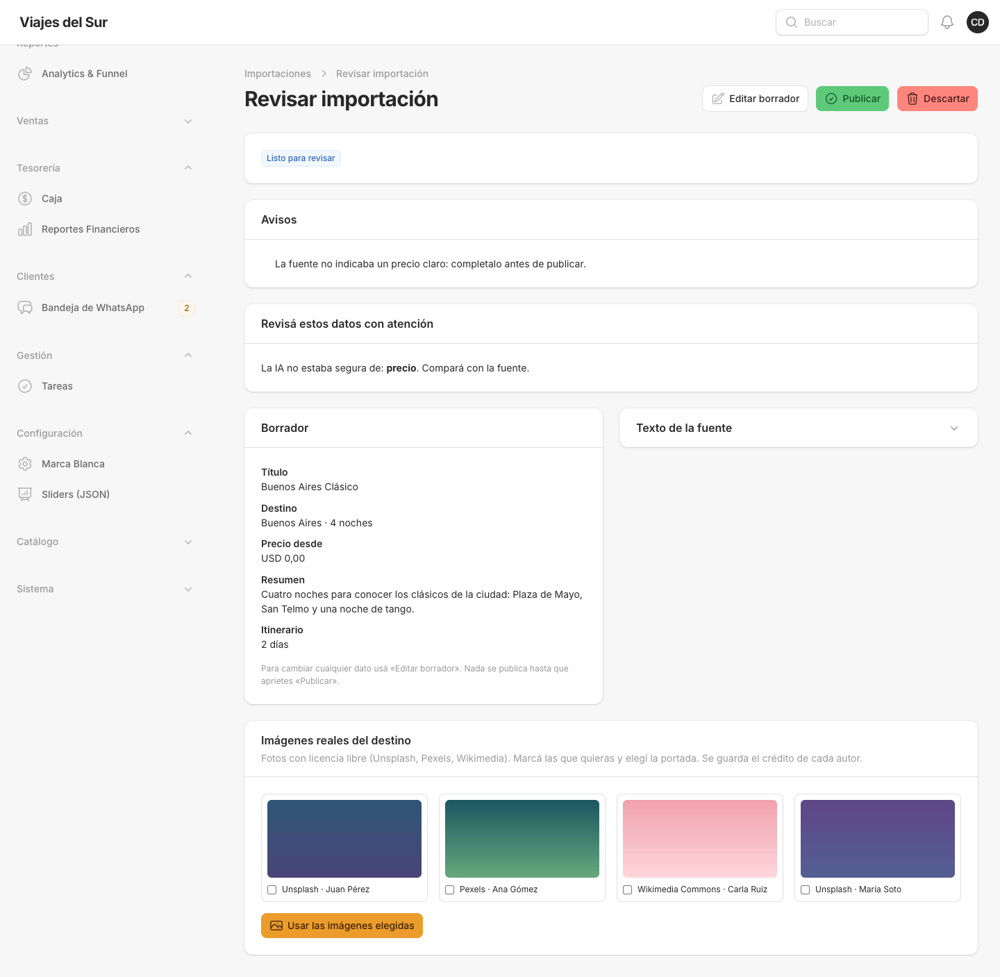

6. **Fotos:** tildá las que te gusten, marcá cuál es la **Portada** y apretá **Usar las imágenes elegidas**.
7. **Editar borrador:** corregí título, precio, itinerario, "Incluye / No incluye". Verificá todos los datos contra la fuente.
8. Volvé a la importación y apretá **Publicar**.

✅ **Salió bien si…** la idea aparece en el catálogo de la web con su foto y el crédito del fotógrafo.

⚠️ **Cuidado:** la IA no inventa datos, pero puede interpretar mal un PDF complicado. El precio, las fechas y lo que incluye **siempre** se verifican a mano. Si falta algo, el sistema no te deja publicar.

---

## Tutorial 9 — Publicar una idea y cuidar la vidriera

⏱ 15 minutos · 👤 Administrador

### Crear una idea a mano

1. **Catálogo → Ideas de Viaje → Nuevo**.

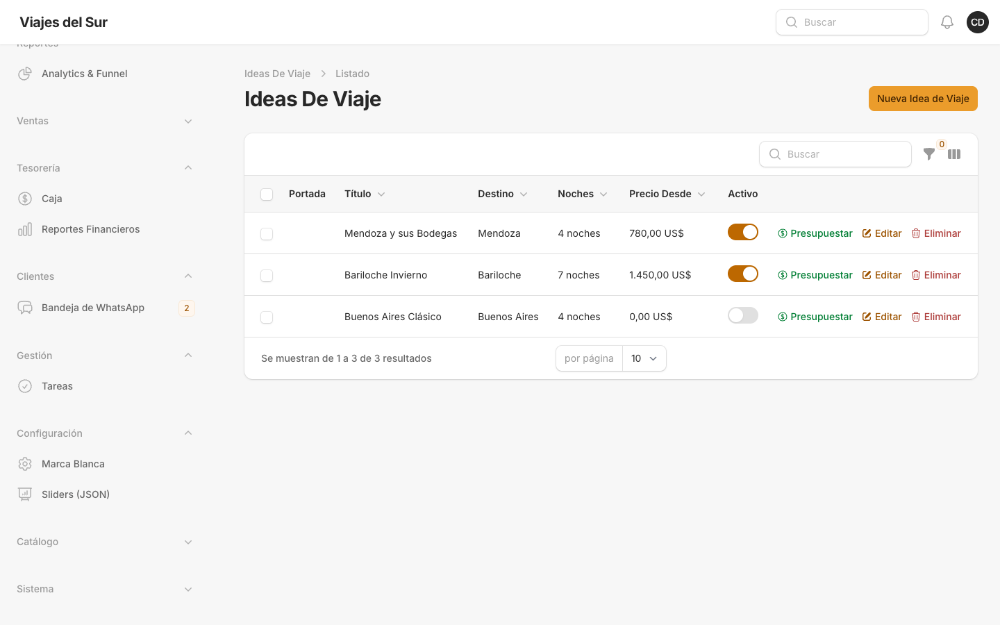

2. **Idea Rápida:** título, destino, noches, precio desde (con moneda y base de precio), resumen y **portada**. Dejá **Activa** prendido para que se vea en la web.
3. **Itinerario:** completá los días (o pedile un borrador a la IA).
4. **Incluye / No Incluye:** una línea por ítem.
5. Guardá.

### Sacarla de la web sin borrarla

Editá la idea y apagá **Activa**.

### Banners del inicio

**Catálogo → Sliders:** cada banner tiene título, subtítulo, descripción, imagen y botones con su texto y enlace.

### Hacer un presupuesto desde una idea

En la lista de ideas, la acción para **generar presupuesto** pide cliente, fecha y pasajeros, y arma el expediente con los servicios de la idea.

---

## Tutorial 10 — Cierre del mes

⏱ 20 minutos · 👤 Finanzas / Administrador

1. **Cobranzas pendientes:** en el Escritorio, tarjeta **Cobranzas** (cuotas vencidas y por vencer). Entrá a cada expediente y gestioná el cobro.
2. **Cargá todo lo que falta** en **Tesorería → Caja**: cobros y pagos del mes, con su comprobante.
3. **Controlá saldos con proveedores:** *Sistema → Proveedores*, columna de saldo en USD.
4. **Resultado del mes:** en el Escritorio, **Ingresos / Egresos del mes** (cobros menos pagos, en dólares).
5. **Balance anual:** *Tesorería → Reportes Financieros* y **Descargar Balance (PDF)**.

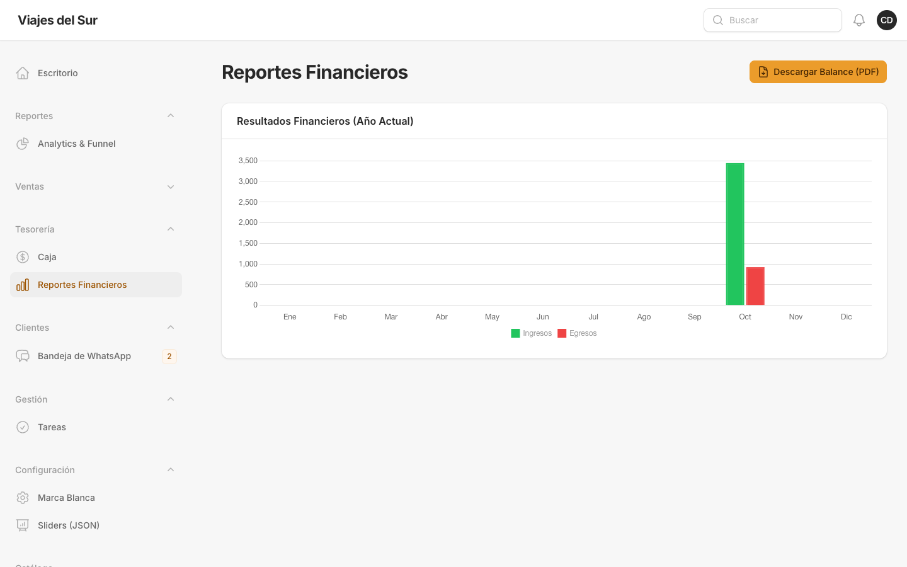

6. **Embudo comercial:** *Reportes → Analytics & Funnel* (consultas, conversión, origen, productos más vendidos).
7. **Velocidad de respuesta:** en el Escritorio, cuánto tardaron en contactar las consultas y cuántos presupuestos se abrieron.

💡 Los reportes toman la **fecha real del movimiento**, no el día en que lo cargaste: podés cargar un cobro atrasado con su fecha verdadera.

---

## Tutorial 11 — Sumar a una persona al equipo

⏱ 5 minutos · 👤 Administrador

1. **Sistema → Usuarios → Nuevo**.

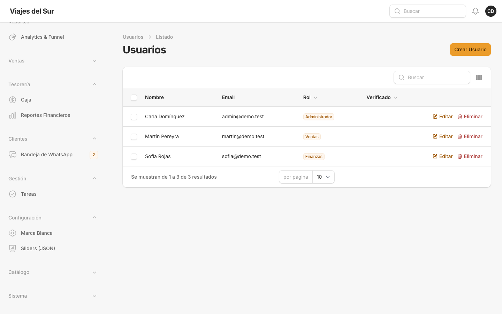

2. Nombre, email, contraseña inicial y **rol**:
   - **Ventas:** trabaja sus consultas, clientes y expedientes,
   - **Finanzas:** ve todos los expedientes, la Caja y los reportes,
   - **Staff:** acceso básico, más los permisos que le tildes,
   - **Administrador:** todo.
3. Si hace falta, tildá **permisos puntuales** (por ejemplo *Gestionar Catálogo / Ideas de Viaje* para quien carga los paquetes, o *Gestionar Clientes*).
4. Guardá y pasale su acceso. Recomendale cambiar la contraseña.

Para quitarle el acceso a alguien, eliminá el usuario o cambiale el rol.

> Solo un **administrador** puede entrar a *Sistema → Usuarios*. Dale ese rol solo a quien de verdad lo necesita: puede ver y cambiar todo.

---

## Tutorial 12 — Qué hacer si…

| Situación | Qué hacer |
|---|---|
| Aparece el aviso rojo **"El cron no está corriendo"** | Los mails y recordatorios están frenados. Avisá a quien administra el hosting (Guía de administración, sección 2). |
| Un servicio en pesos no se puede guardar | Falta la cotización: elegí una del selector o escribila. |
| El cliente dice que no le llegó el mail | Mirá en **Actividad** si figura el envío; pedile que revise spam; podés mandarle el **Link Público** por WhatsApp. Si no sale ningún mail, avisá al administrador (correo saliente). |
| Cargué un cobro mal | Editá o eliminá el movimiento en **Caja**: las cuotas y el saldo se recalculan solos. |
| El presupuesto venció | Botón **Renovar validez** en el expediente. |
| La IA contestó algo raro por WhatsApp | Respondé vos desde la bandeja (la IA se pausa sola) y avisá al administrador para ajustar. |
| Se importó una idea con datos dudosos | No la publiques: **Editar borrador** y corregí, o **Descartar**. |
| Dos clientes aparecen mezclados | Abrí la consulta y revisá email y teléfono; corregilos desde **Editar**. |
| No veo una opción del menú | Es por tu rol. Pedile al administrador el permiso. |
| El bot no le contestó a un cliente | Fijate si alguien del equipo le respondió hace poco (el bot se pausa) y revisá *Chat → Avisos*: ahí queda si llegó al tope diario o al límite de gasto. |
| El bot dijo algo que no debía | Respondé vos desde la bandeja y ajustá sus *Instrucciones* en *Chat → Bot recepcionista*. Probalo con **Probar bot** antes de volver a encenderlo. |
| No aparece **Enviar PDF por WhatsApp** | El cliente no tiene una conversación de WhatsApp abierta. Si está en gris, pasaron más de 24 horas: mandale una plantilla desde la bandeja. |
| La pestaña **Para hoy** tiene demasiadas consultas | Poné fecha de **próximo seguimiento** a las que no son para hoy y cerrá las que ya no siguen. |

---

## Tutorial 13 — Configurar y probar el bot recepcionista

⏱ 20 minutos · 👤 Administrador · ⚙️ *Requiere la IA y al menos un canal conectados*

1. Entrá a **Chat → Bot recepcionista**. Dejá el interruptor **apagado** mientras lo configurás.
2. En **Qué dice → Instrucciones**, escribí como le explicarías el trabajo a una persona nueva. Por ejemplo:
   > *"Saludá con el nombre de la agencia. Si preguntan por Brasil, contá que tenemos salidas grupales en enero. Si preguntan por horarios, atendemos de lunes a viernes de 9 a 18."*
3. En **Cuándo derivar a una persona**, sumá tus casos. Por ejemplo: *"grupos de más de 10 personas"*, *"viajes de egresados"*.
4. En **Promociones vigentes**, cargá las que estén publicadas, con sus fechas. El bot solo las menciona mientras están vigentes.
5. En **Horario y topes**, marcá los días y el horario del equipo. Dejá la pausa en 12 horas y un tope razonable de respuestas por día (por ejemplo 30).
6. En **Proveedor de IA**, poné un **límite de gasto mensual** y los precios por millón de tokens de tu proveedor, así el sistema puede calcular cuánto se gastó.
7. Apretá **Guardar**.
8. Apretá **Probar bot** y escribile como un cliente: *"Hola, quiero ir a Bariloche en julio con mis dos hijos"*. Fijate que:
   - responda corto y pregunte de a poco,
   - al costado vaya completando los datos del viaje,
   - si le preguntás *"¿cuánto sale?"* o *"¿cómo pago?"*, derive a una persona,
   - cuando la pregunta es de sí o no, proponga botones.
9. Si algo no te gusta, ajustá las instrucciones y volvé a probar. Cuando esté bien, **encendé el interruptor** y guardá.

✅ **Salió bien si…** al escribirle desde tu celular al WhatsApp o al Instagram de la agencia, el bot responde y la consulta aparece en *Ventas → Consultas* con los datos que le diste.

💡 Mientras el bot está encendido, todo lo que una persona del equipo responda (desde el sistema o desde el celular) lo pone en pausa en esa conversación.

---

## Tutorial 14 — Mandar el presupuesto en PDF por WhatsApp

⏱ 3 minutos · 👤 Ventas · ⚙️ *Requiere WhatsApp conectado*

**Antes de empezar:** el cliente tiene que haberte escrito por WhatsApp en las últimas 24 horas.

1. Abrí el expediente en **Ventas → Presupuestos / Files**.
2. Arriba a la derecha, apretá **Enviar PDF por WhatsApp**.
3. Elegí el formato: **Solo Presupuesto** o **Presupuesto + Detalle de la Idea de Viaje**.
4. Revisá el **mensaje** que acompaña al PDF. Viene armado con el nombre y el destino, y lo podés cambiar.
5. Apretá **Enviar**.

✅ **Salió bien si…** aparece el aviso *"Presupuesto enviado por WhatsApp"*, el PDF se ve en la conversación de la **Bandeja de mensajes** y en el **Historial de Actividad** del expediente figura el envío.

💡 Si el botón está en gris, pasaron más de 24 horas. Mandale una plantilla desde la bandeja, esperá su respuesta y volvé a intentar. Si el botón no aparece, el cliente todavía no tiene una conversación de WhatsApp: usá **Abrir en WhatsApp** para escribirle desde tu celular.

---

## Tutorial 15 — Controlar a los pasajeros que viajan pronto

⏱ 10 minutos por semana · 👤 Ventas / Finanzas

1. Entrá a **Ventas → Presupuestos / Files**. Abre en la pestaña **Viajan en 30 días**, con el viaje más cercano primero.
2. Para cada uno, revisá que tenga vouchers, pasajeros completos y el saldo al día.
3. Pasá a la pestaña **Sin vouchers**: son los que salen en 45 días o menos y todavía no tienen documentos. Cargalos en *Información adicional* del expediente.
4. Pasá a **Cuotas vencidas**: entrá a cada uno y registrá el pago o llamá al cliente.
5. Terminá con **Presupuestos por vencer**: llamá al cliente o usá **Renovar validez** si todavía le interesa.

✅ **Salió bien si…** las pestañas **Sin vouchers** y **Cuotas vencidas** quedan en cero, o solo con casos que ya están hablados con el cliente.

