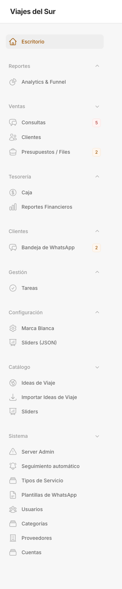

# Guía rápida

## Tu rutina diaria (10 minutos)

1. **Consultas → pestaña "Para hoy":** trabajala de arriba hacia abajo. Ya viene ordenada por urgencia.
2. **Bandeja de mensajes y Avisos** *(si usan WhatsApp, Instagram o Messenger)*: respondé las no leídas y resolvé los avisos del bot.
3. **Tareas:** abrí *Gestión → Tareas*. El sistema te deja tareas automáticas (llamar a un cliente, cerrar una venta).
4. **Presupuestos / Files → "Viajan en 30 días" y "Cuotas vencidas":** que nadie viaje sin vouchers ni con cuotas atrasadas.
5. **Caja:** cargá los cobros y pagos del día.

**Una vez por semana:** revisá el **Tablero de consultas** y mové cada tarjeta a su etapa.

## Dónde está cada cosa (menú de la izquierda)

| Grupo | Contiene |
|---|---|
| **Reportes** | Analytics & Funnel |
| **Ventas** | Consultas · Tablero de consultas · Clientes · Presupuestos / Files |
| **Tesorería** | Caja · Reportes Financieros |
| **Chat** | Bandeja de mensajes · Bot recepcionista · Avisos |
| **Gestión** | Tareas |
| **Configuración** | Marca Blanca (todos los ajustes de la agencia) · Sliders (JSON) |
| **Catálogo** | Ideas de Viaje · Importar Ideas de Viaje · Convertir PDF a texto · Sliders |
| **Sistema** | Server Admin · Seguimiento automático · Tipos de Servicio · Canales de mensajería · Plantillas de WhatsApp · Usuarios · Categorías · Proveedores · Cuentas |

(Cada persona ve solo lo que su rol permite.)

## Los estados que tenés que conocer

**Consulta:** Nueva → En curso → Cotizada → Reservada (o Cerrada) · *Por verificar*: la abrió el bot y hay que confirmarla
**Temperatura:** 🔵 Frío · 🟡 Tibio · 🔴 Caliente
**Expediente:** Borrador → Presupuesto → **Señado** (pagó la seña) → Emitido → (Cancelado)
**Cuota:** Pendiente · Pago parcial · Pagada · Vencida

## Tres reglas de oro del dinero

1. **Todo expediente se lleva en dólares (USD).** Si algo se cobra o se compra en pesos, el sistema lo convierte con la cotización que elijas.
2. **La cotización se elige en cada operación:** Oficial, MEP, Tarjeta o Personalizada. Queda guardada, así los números de hoy no cambian cuando el dólar se mueve.
3. **El saldo del cliente = total del viaje en USD − lo cobrado en USD.** Un cobro en pesos suma lo que valían esos pesos el día que se pagaron.

## Atajos útiles

| Quiero… | Hago… |
|---|---|
| Armar un presupuesto desde una consulta | *Consultas* → ⋯ → **Crear Expediente** |
| Mandarle el presupuesto al cliente | Dentro del expediente: **Enviar PDF por WhatsApp** / **Enviar por Email** / **Ver Link Público** |
| Cambiar de etapa una consulta | **Tablero de consultas**: arrastrá la tarjeta a otra columna |
| Armar cuotas | Expediente → pestaña **Plan de Pagos** → **Generar plan** |
| Cobrar una cuota | **Plan de Pagos** → **Registrar pago** en la fila de la cuota |
| Renovar un presupuesto vencido | Botón **Renovar validez** en el expediente |
| Pasar del bot a una persona | Responder desde la bandeja o desde el celular (el bot se pausa solo) |
| Cambiar lo que dice el bot | *Chat → Bot recepcionista* → **Instrucciones**, y **Probar bot** |
| Cargar una idea desde la web de un operador | *Catálogo → Importar Ideas de Viaje* |

## Si algo no anda

- Aviso rojo **"El cron no está corriendo"** → avisá a quien administra el hosting (Guía de administración, sección 2).
- Los mails o respuestas automáticas tardan hasta **1 minuto**: es normal.
- No te deja guardar un servicio en pesos → falta la cotización: elegí una del selector o escribila.
- El bot no contesta → alguien del equipo respondió hace poco (se pausa) o llegó a un tope: mirá *Chat → Avisos*.
