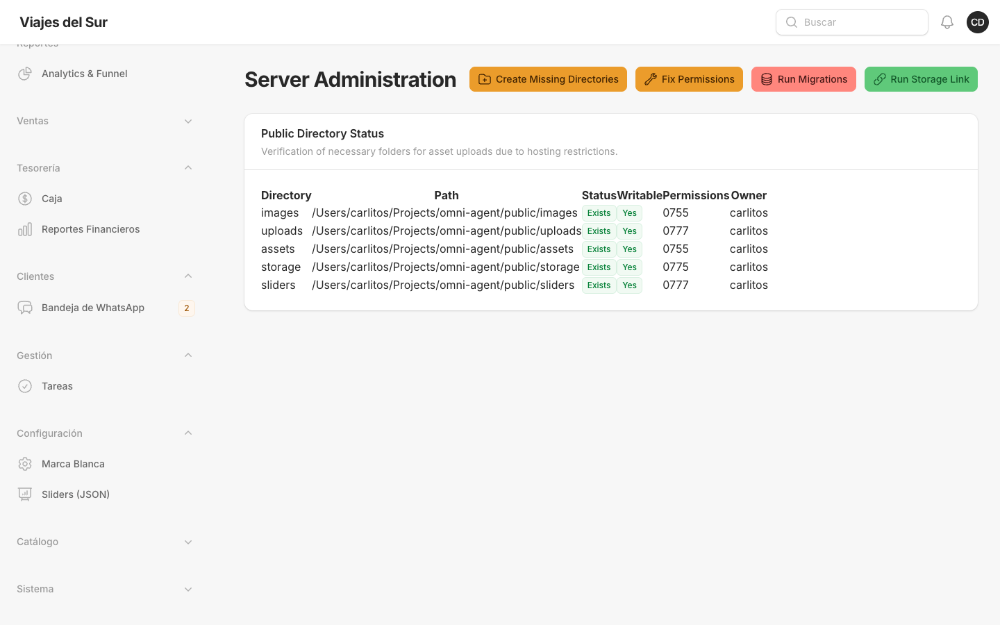
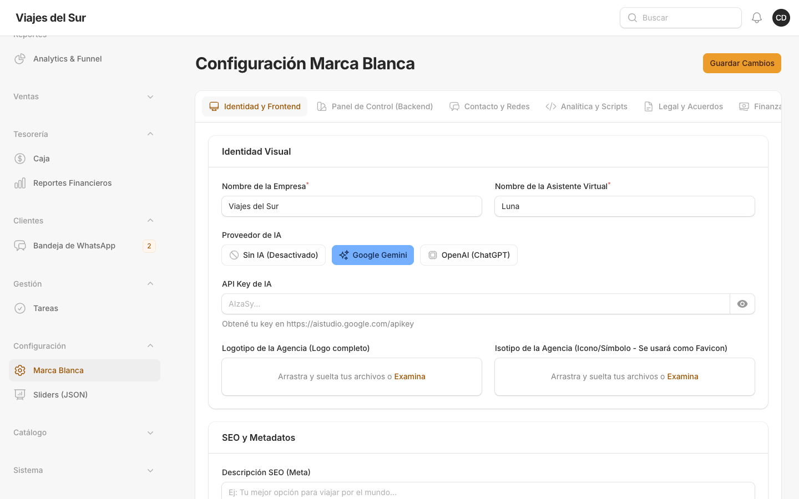
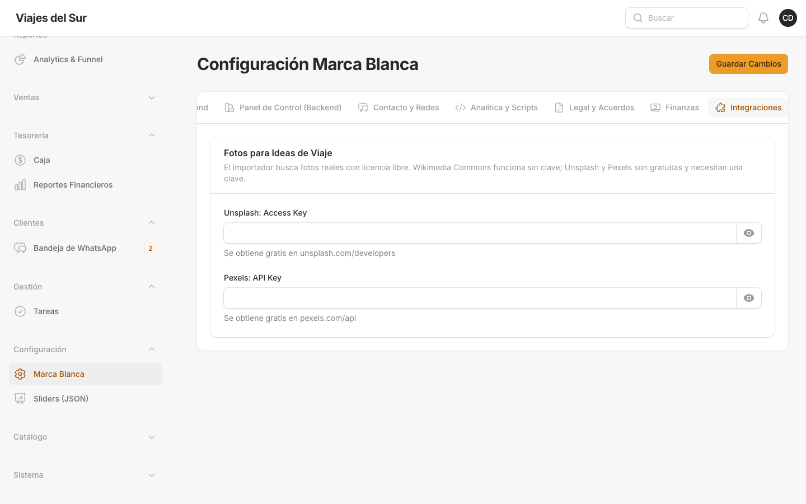
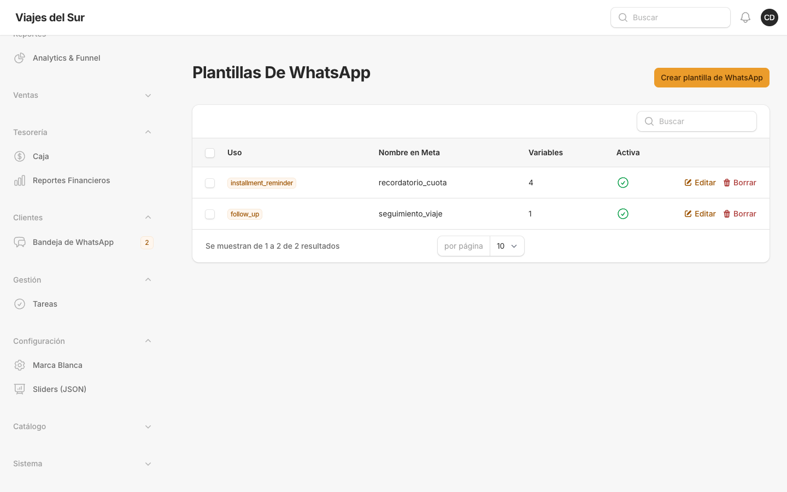

# Guía de administración

Para la persona que deja el sistema instalado y funcionando (o que habla con el hosting). Usa lenguaje simple, pero algunas tareas se hacen en el panel del hosting (cPanel o hPanel), no en el sistema.

**Índice**

1. Requisitos del hosting
2. El "cron": lo más importante para que todo funcione solo
3. Revisar que todo esté bien (`omni:doctor` y Server Admin)
4. Correo saliente
5. Inteligencia artificial
6. Fotos para el importador
7. WhatsApp, Instagram y Messenger
8. Datos que ya existían: recálculo de totales
9. Copias de seguridad
10. Actualizaciones
11. Seguridad

---

## 1. Requisitos del hosting

- **PHP 8.4** (se elige en el panel del hosting) con las extensiones habituales: mbstring, gd, zip, curl, pdo_mysql, fileinfo.
- **MySQL/MariaDB**.
- Poder crear **una tarea programada (cron)**. Está disponible en cPanel (*Avanzado → Trabajos de Cron*) y hPanel (*Avanzado → Trabajos Cron*).
- Un **certificado SSL** (https). Es indispensable para WhatsApp.
- No hace falta Redis ni procesos permanentes: el sistema funciona en hosting compartido.

## 2. El "cron": lo más importante para que todo funcione solo

Los **mails, recordatorios de cuotas, seguimientos automáticos, respuestas de IA y la importación de ideas** se procesan en segundo plano. Para eso el hosting tiene que "despertar" al sistema **cada minuto**.

**Cómo crearlo (una sola vez):**

1. En el panel del hosting, entrá a *Trabajos de Cron* y creá una tarea **cada minuto** (`* * * * *`).
2. En el comando poné:
   ```
   cd /RUTA/AL/PROYECTO && /RUTA/A/PHP8.4 artisan schedule:run >> /dev/null 2>&1
   ```
   Ejemplos de la ruta de PHP según hosting: `/usr/local/bin/php` o `/opt/cpanel/ea-php84/root/usr/bin/php` (cPanel) y `/opt/alt/php84/usr/bin/php` (hPanel). Si no estás seguro, preguntale al soporte del hosting "¿cuál es la ruta del PHP 8.4 para cron?".
3. Esperá 2 o 3 minutos.

**Cómo saber que funciona:** entrá al panel de administración. Si aparece el aviso rojo **"El cron no está corriendo"** (con el comando exacto para copiar), todavía no está andando. Si no aparece, está bien.

**Importante:** con este cron, lo que sale "en segundo plano" tarda **hasta 1 minuto** (por ejemplo, una respuesta automática de WhatsApp). Es normal.

**Si el hosting no deja crear un cron**

Se puede usar un servicio externo gratuito que visite una dirección del sistema cada minuto:

1. Inventá una clave larga y cargala en el `.env` como `CRON_TOKEN=...`.
2. En el servicio externo, programá una visita **cada minuto** a `https://TU-DOMINIO/cron/run?token=LA-CLAVE`.

Mientras `CRON_TOKEN` esté vacío, esa dirección no existe. No compartas la clave: quien la tenga puede disparar las tareas programadas.

## 3. Revisar que todo esté bien

### Desde el sistema (sin terminal)

*Menú **Sistema → Server Admin*** ofrece botones para:

- **Create Missing Directories** (crea carpetas que falten),
- **Fix Permissions** (permisos de carpetas),
- **Run Migrations** (aplica actualizaciones de la base de datos; hacé un backup antes),
- **Run Storage Link** (publica las imágenes subidas).




### Con terminal (SSH), si el hosting lo permite

```
php artisan omni:doctor
```

Revisa: versión de PHP, extensiones, permisos, base de datos, enlace de imágenes, cola, **cron activo**, trabajos fallidos y si hay cotización del dólar. Cada punto con problema trae la solución.

Si tu hosting **no tiene terminal**, podés correr un comando creando un cron temporal de una sola corrida (y borrándolo después).

## 4. Correo saliente

Los mails (confirmación de consulta, presupuesto, recordatorios de pago, recuperar contraseña) necesitan una cuenta de correo SMTP. Se configura en el archivo `.env` del servidor (líneas `MAIL_MAILER`, `MAIL_HOST`, `MAIL_PORT`, `MAIL_USERNAME`, `MAIL_PASSWORD`, `MAIL_FROM_ADDRESS`).

Recomendación: usar una casilla de la propia agencia (por ejemplo `no-responder@tuagencia.com`) y pedirle al hosting que configure **SPF y DKIM** para que los mails no caigan en spam.

Prueba rápida: enviá un presupuesto por email a tu propia casilla.

## 5. Inteligencia artificial

La IA se usa para: el **chat del sitio**, la **calificación de consultas** (completar destino, fechas, presupuesto…), el **bot recepcionista** de WhatsApp, Instagram y Messenger, el **borrador de itinerario** y el **importador de ideas**.

**Configuración:** *Configuración → Marca Blanca → Identidad y Frontend* (o *Chat → Bot recepcionista → Proveedor de IA*, que es el mismo ajuste) → elegí el **proveedor**, pegá la **clave de API**, revisá el **modelo** y ponele nombre al asistente. Después apretá **Guardar y probar IA**.

| Proveedor | Comentario |
|---|---|
| **Google Gemini** | Lee PDFs en el importador. La clave se saca en Google AI Studio. |
| **OpenAI (ChatGPT)** | Lee PDFs en el importador. La clave se saca en platform.openai.com. |
| **Groq (gratis)** | Tiene un nivel gratuito, con límites de uso. No lee PDFs: para el importador, pegá el texto o usá un link. |
| **Otro compatible con OpenAI** | Para proveedores que copian la API de OpenAI. Pide además la **URL del proveedor** y el **modelo**. |

La clave queda **cifrada** y el panel nunca vuelve a mostrarla completa. Para cambiarla, pegá una nueva; si dejás el campo vacío, se conserva la actual.

**Controlar el gasto:** en *Chat → Bot recepcionista → Proveedor de IA* cargá un **límite de gasto mensual (USD)** y los **precios por millón de tokens** que publica tu proveedor. El panel muestra cuánto se gastó en el mes. Al llegar al límite, el bot deja de responder, avisa a los administradores una vez y le dice al cliente que una persona se va a comunicar.




El uso de la IA **tiene un costo** que cobra el proveedor según el consumo. El sistema limita la cantidad de mensajes por minuto para evitar abusos.

Sin clave, el chat sigue funcionando con preguntas guiadas simples, pero sin inteligencia, y el importador de ideas no funciona.

## 6. Fotos para el importador

*Configuración → Marca Blanca → Integraciones.*

- **Wikimedia Commons** no necesita clave.
- **Unsplash**: creá una cuenta de desarrollador gratuita (unsplash.com/developers), registrá una aplicación y pegá la *Access Key*.
- **Pexels**: pedí la clave gratuita en pexels.com/api y pegala.

Las fotos se descargan al sistema, y se guarda el crédito del autor.




## 7. WhatsApp, Instagram y Messenger

Los tres canales entran a la misma **Bandeja de mensajes**. Es la parte que más trámites tiene: conviene empezarla con anticipación. Para WhatsApp hay dos formas de conectarse; elegí una.

| | **A) Cloud API de Meta, directo** | **B) A través de Zernio** |
|---|---|---|
| El número sigue en la app **WhatsApp Business** del celular | No: el número queda solo para el sistema | **Sí** (coexistencia): el equipo puede seguir usando el celular |
| Trámite con Meta | App propia de Meta, verificación del negocio | Lo guía Zernio, que es proveedor técnico de Meta |
| Costo | Lo que cobra Meta por conversación | Lo que cobra Meta más la suscripción de Zernio |
| Variable en el `.env` | `WHATSAPP_PROVIDER=cloud` | `WHATSAPP_PROVIDER=zernio` |

En las dos opciones hacen falta **plantillas aprobadas por Meta** para escribir pasadas las 24 horas y para los recordatorios de pago.

### A) WhatsApp con la Cloud API de Meta

**Qué necesitás**

- Una cuenta de **Meta Business** verificada.
- Una app de Meta con el producto **WhatsApp** y un **número de teléfono** dedicado (no puede estar usándose en la app de WhatsApp común).

**Pasos**

1. En el panel de Meta (developers.facebook.com) anotá: **Phone number ID**, un **token de acceso permanente**, y el **App Secret** de la app.
2. Inventá una frase secreta como **token de verificación** (cualquier texto largo).
3. En el `.env` del servidor cargá:
   ```
   WHATSAPP_PROVIDER=cloud
   WHATSAPP_PHONE_NUMBER_ID=...
   WHATSAPP_ACCESS_TOKEN=...
   WHATSAPP_APP_SECRET=...
   WHATSAPP_VERIFY_TOKEN=...   (la frase que inventaste)
   ```
4. En Meta, en *WhatsApp → Configuración → Webhook*, pegá la URL `https://TU-DOMINIO/webhooks/whatsapp` y el mismo token de verificación. Suscribite al campo **messages**.
5. Si la agencia tiene **más de un número**, cada uno se carga en *Sistema → Canales de mensajería* con su propio ID y token.

### B) WhatsApp a través de Zernio (el número sigue en el celular)

1. Creá una cuenta en Zernio y conectá ahí el número de WhatsApp Business. Zernio guía el trámite con Meta.
2. En Zernio, creá una **clave de API** y anotá el **ID de la cuenta de WhatsApp** conectada.
3. En Zernio, registrá el webhook con la URL `https://TU-DOMINIO/webhooks/zernio`, una **clave secreta** inventada por vos y estos eventos: `message.received`, `message.sent`, `message.delivered`, `message.read` y `message.failed`.
4. En el `.env` del servidor cargá:
   ```
   WHATSAPP_PROVIDER=zernio
   ZERNIO_API_KEY=...
   ZERNIO_WHATSAPP_ACCOUNT_ID=...
   ZERNIO_WEBHOOK_SECRET=...   (la misma clave del paso 3)
   ```
5. **Para probar sin molestar a clientes:** cargá tu número en `ZERNIO_TEST_PHONES=+549...`. Mientras tenga un valor, el sistema ignora los mensajes de cualquier otro número. **Dejalo vacío en producción.**

Con esta opción, lo que el equipo escribe desde el celular también entra a la bandeja (marcado **Celular**) y pausa al bot en esa conversación.

### Plantillas de WhatsApp (para las dos opciones)

En *Sistema → Plantillas de WhatsApp* cargá cada plantilla aprobada con su nombre **exacto**, idioma, texto y cantidad de variables. Para los recordatorios de cuotas, usá el uso *"Recordatorio de cuota"* con 4 variables, en este orden: **nombre, cuota, monto, vencimiento**.



### Instagram y Messenger

Se conectan desde *Sistema → Canales de mensajería*, una cuenta por fila.

1. Arriba de esa pantalla, en **Dónde pegar en Meta**, están las dos URL de webhook para copiar.
2. **Nuevo canal:** elegí *Instagram* o *Messenger*, poné un **nombre interno** (por ejemplo "Instagram de la agencia"), el **ID** de la cuenta o página, cómo se conectó, el **token de acceso**, el **secreto de la app** y un **token de verificación** inventado.
3. En la app de Meta, registrá el webhook con la URL y el token de verificación, y suscribite a los mensajes.
4. Opcional: **Permitir que una persona responda hasta 7 días después** (etiqueta "Agente humano" de Meta). Activalo solo si tu app tiene ese permiso. La IA nunca la usa.

Opcional: si cargás `META_WEBHOOK_TOKEN=...` en el `.env`, la URL del webhook de Instagram y Messenger lleva esa clave al final. Es una segunda capa de seguridad, además de la firma de Meta.

Si un token vence, el canal queda marcado para **reconectar**: cargá un token nuevo y vuelve a enviar.

### Probar

Escribí al número o a la cuenta desde tu celular. Deberías ver la conversación en *Chat → Bandeja de mensajes* en menos de un minuto. Después configurá el bot (Tutorial 13) **antes** de encenderlo.

Los datos secretos (tokens, secretos, claves de API) se guardan en el `.env` o **cifrados** en la base, y nunca se muestran completos en pantalla.

## 8. Datos que ya existían: recálculo de totales

Si el sistema ya se usaba antes de esta versión, los expedientes viejos pueden tener servicios en pesos contados como si fueran dólares. Hay un procedimiento seguro para corregirlo (con simulación previa y backup), que conviene coordinar con quien instala el sistema. Resumen:

1. Backup de la base de datos.
2. **Simulación** (no cambia nada): `php artisan omni:recalculate-bookings` y revisar el archivo CSV que genera.
3. Para los servicios en pesos sin cotización, decidir si se carga la cotización histórica a mano o se usa la del día (`--estimate-rates=oficial`).
4. **Aplicar:** `php artisan omni:recalculate-bookings --apply`.
5. Si hay consultas anónimas que quedaron mezcladas en un mismo cliente: `php artisan omni:split-anonymous-customers` (simulación) y luego `--apply`.
6. Antes de dejar corriendo el seguimiento automático por primera vez: `php artisan omni:run-follow-ups --baseline` (marca lo viejo como "ya atendido" para no llenar al equipo de tareas por consultas antiguas).

## 9. Copias de seguridad

- **Base de datos:** exportación completa desde phpMyAdmin (o la herramienta de backup del hosting) **antes** de cada actualización y, como mínimo, una vez por semana.
- **Archivos subidos:** la carpeta `public/uploads` (imágenes) y `storage/app` (documentos, vouchers).
- Guardá las copias **fuera** del hosting (tu computadora o un servicio en la nube).

## 10. Actualizaciones

1. Hacer backup (sección 9).
2. Poner el sistema en **modo mantenimiento** (*Configuración → Mantenimiento*).
3. Subir el paquete nuevo y descomprimirlo encima, **sin tocar `.env`**.
4. Aplicar las migraciones (*Server Admin → Run Migrations*).
5. Si el panel se ve raro, borrar los archivos de `bootstrap/cache/`.
6. Desactivar el modo mantenimiento y revisar el aviso del cron.

## 11. Seguridad

- Cambiá las contraseñas iniciales y usá contraseñas largas y únicas.
- Dale a cada persona el **rol mínimo** que necesita (el dinero y la rentabilidad solo para Finanzas y administradores). Solo los **administradores** manejan usuarios, así que limitá ese rol a quien de verdad lo necesita.
- Recordá que el **DNI o pasaporte** del cliente es lo que usa para entrar a su portal: por eso la agenda de clientes pide permiso.
- Mantené `APP_DEBUG=false` en producción.
- No compartas el `.env` ni las claves de IA / WhatsApp por mail o chat.
- Los formularios públicos y el chat tienen protecciones contra robots y límites de uso. Los webhooks de WhatsApp, Instagram, Messenger y Zernio rechazan todo lo que no venga firmado.
- Si usás la conexión externa de consultas (`POST /api/leads`), cargá `LEADS_API_TOKEN` en el `.env`: sin esa clave, cualquiera puede crear consultas por esa vía.
- Para que el PDF del presupuesto llegue por WhatsApp, `APP_URL` tiene que ser la dirección **https** pública del sitio: WhatsApp descarga el archivo desde ahí.
